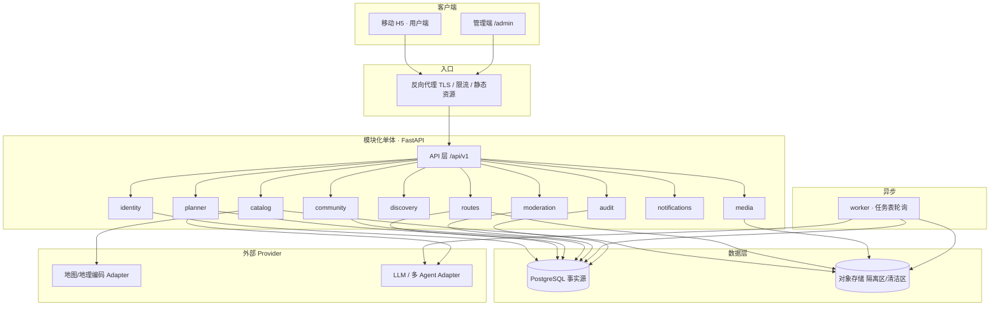

# CulturalWalk 总体开发文档

> 版本：v2.0（2026-10）
> 适用：文化行走平台 · 长沙单城原型
> 阶段定位：**国创申报/答辩材料 + 可演示原型**，不做公网硬化
> 上游依据：本目录 `docs/` 下四份规划文档（v0.1 架构、v1.0 架构、新手手册、技术栈方案）。本文档与它们冲突时，**以本文档为准**，因为产品范围已经扩展。

---

## 0. 一句话

用户说「长沙、2 天、3 人、1000 元、想看点真有文化的东西」，平台给出的**不是一串景点**，而是**一条切合这次出行、讲得清文化脉络的线路**：

> 我们的推荐是当地独有、有传承脉络、带着乡土气的文化线路。
> 让你在这条路上不是旁观者，而是亲历者——走过之后，说得出这段文化的来历，也成了它的传播者。

四条要求（缺一条就不合格）：

- **切合需求**：天数、预算、体力、同行人是**硬框**，走不通的组合直接不出，不硬塞；
- **有文化内涵**：2–3 个相邻主题分段讲，每段说得清"在讲什么"，段与段之间接得上——文化是主线，不是景点旁边的注解；
- **有据可查**：每个说法挂来源（文献 / 官方网站 / 地方志 / 口述），查不到就标「待核实」，不假装确定；
- **可延续**：能保存、分享，也能一键变成投稿草稿，经审核进入社区，被更多人照着走、评论补充。

一句话：**别的产品告诉你「哪里值得去」，我们回答「你这一次该怎么走，这一路的文化到底讲了什么」。**

## 1. 已锁定的产品决策

这 6 条是已经和项目负责人确认过的，后续开发不再讨论，除非负责人改口。

| # | 决策 | 内容 |
|---|---|---|
| 1 | 阶段目标 | 国创申报/答辩 + 可演示原型。不做 ICP 备案、不做公网压测、不接真实支付 |
| 2 | 内容双通道 | ① 平台精选：编辑主导，可用 AI 生成初稿，编辑核来源后发布；② 用户路线：任何注册用户上传自己的路线，管理员审核通过后发布 |
| 3 | 共创定义 | **不是共同编辑同一条路线**，而是「人人可投稿自己的路线 + 平台审核 + 发布到社区」。一条路线一个作者 |
| 4 | 城市范围 | 首发只做**长沙**单城、城市内行程。数据结构按多城多日设计，跨城放二期 |
| 5 | 行程精度 | 顺序 + 停留时长 + 交通方式 + 费用区间 + 资料来源。**不承诺**精确到分钟、不承诺实时营业/实时路况 |
| 6 | 账号与署名 | 注册用户体系；路线详情和个人主页显示用户名，可点进主页看该用户已发布的路线 |
| 7 | 目标用户 | **外地第一次来长沙的年轻游客**。不做「所有人」，避免内容取向被稀释 |
| 8 | 内容把关 | **机器初筛 + 人工终审**：机器抓官网/文献/口述并打来源标签，编辑点开核对后才公开；**公开内容里没有来源的说法不显示** |
| 9 | 输出形态 | **故事优先**：先讲这条线是什么文化、每处有什么讲究，再展开成时间表式行程（几点到哪、交通、费用区间） |
| 10 | 社区排序 | 人人可发、审核后公开；列表默认按**收藏数**排，不按发布时间 |

---

## 2. 角色与权限

| 角色 | 能做什么 | 不能做什么 |
|---|---|---|
| 访客 visitor | 浏览、搜索、筛选、看路线详情与作者主页 | 投稿、评论、收藏、生成行程 |
| 注册用户 user | 上传自己的路线、编辑草稿、提交审核、评论、收藏、生成并保存行程、查看自己主页 | 审核、发布、下线 |
| 管理员 admin | 审核通过/退回（须写理由）、发布、下线、管理平台精选、管理用户 | 直接改用户草稿内容（只能退回让作者改） |
| 编辑 editor | 生产/维护平台精选路线，可审核 | 管理账号与角色 |
| 系统 system | 异步任务：扫描、缩略图、AI 生成、通知 | 审核、发布、下线 |

**硬规则**：权限一律在后端校验；前端隐藏按钮不算权限。管理员不能审自己提交的路线。

---

## 3. 功能范围

### 3.1 MVP（答辩必须演示到）

1. 注册 / 登录 / 退出
2. 浏览路线列表、按主题和时长筛选、关键词搜索
3. 路线详情：节点顺序、每个节点的文化说明与来源、费用区间、地图点位与外部导航跳转
4. 用户创作：新建路线草稿 → 加节点 → 填来源与媒体 → 提交审核
5. 审核后台：待审列表、查看 diff、通过 / 退回（写理由）
6. 发布与下线：发布后公开可见；下线后前台 404
7. 行程规划：输入城市/天数/人数/预算/偏好 → 生成行程 → 保存 / 分享链接 / 一键转成路线草稿
8. 社区互动：评论、作者置顶一条评论、收藏
9. 个人主页：用户名、简介、已发布路线列表
10. 审计日志：谁在什么时候审了/发了/下线了哪条路线的哪个版本

### 3.2 二期（写进申报书，不做）

- 跨城/多城市行程、住宿与城际交通
- 路线共创编辑（多人协作同一条）
- 关注、粉丝、消息通知推送
- 真实地图路线规划与实时数据
- 举报与申诉流程、内容分级
- 多城市复制、运营数据看板

### 3.3 明确不做

- 原生 App、小程序、离线地图
- 支付、预订、票务对接
- 微服务、K8s、消息队列
- 自建道路级最短路径
- AI 自动发布内容

---

## 4. 系统架构



**四条架构原则**

1. **模块化单体**：一个部署单元，模块之间只通过应用服务（函数/端口）调用，不直接读写别人的表。
2. **契约先行**：`docs/api/openapi.yaml` 是 HTTP 接口唯一事实源，前端类型由它生成。
3. **事实可追溯**：对外可见的永远是「某个路线的某个不可变版本」，不是「最新数据」。
4. **外部不可信**：地图、LLM 的返回一律经 Adapter 校验后才入库；密钥只在服务端。

---

## 5. 模块清单与边界

每个模块 = 一个最小可认领单元。详细任务卡见 [01-模块与任务看板.md](./01-模块与任务看板.md)。

| 模块 | 职责 | 拥有数据 | 不负责 | 负责人 |
|---|---|---|---|---|
| `identity` | 注册、登录、会话、角色、用户主页数据 | User, Session | 路线内容、审核 | P2 |
| `catalog` | 地点库：地点、坐标、文化资料、来源、开放时间 | Place, PlaceSource, PlaceFact | 路线编排、发布 | P3 |
| `routes` | 路线草稿、节点、顺序、版本快照、费用汇总 | Route, RouteDraft, RouteVersion, RouteNode | 审核、发布、AI | P3 |
| `planner` | 行程生成：输入 → 多 Agent 编排 → 行程对象 | Itinerary, PlanRun, AgentStep | 路线投稿、发布 | P4 |
| `discovery` | 公开列表、搜索、筛选、首页聚合（只读查询层，无自己的表） | 只读投影 | 写任何业务表 | P4 |
| `community` | 评论、作者置顶、收藏 | Comment, Favorite | 路线内容修改 | P3 |
| `moderation` | 审核队列、领取、通过/退回、发布、下线 | Submission, ReviewTask, Publication | 编辑内容本身 | P1 |
| `media` | 上传意图、隔离区、扫描、缩略图、EXIF 清理 | MediaAsset | 内容审核 | P3 |
| `notifications` | 站内通知：审核结果、发布成功 | Notification | 推送短信/邮件 | P2 |
| `audit` | 审计写入与受限查询 | AuditLog | 业务状态变更 | P1 |

**依赖方向（禁止反向）**

```
routes → catalog
planner → catalog, routes(只读)
moderation → routes, audit
community → routes(只读), identity
discovery → routes, catalog, community(只读)
media → identity
notifications → identity
audit ← 所有模块（只写）
```

出现循环依赖必须先写 ADR，不允许「先 import 了再说」。

---

## 6. 核心对象与状态机

详细字段与流转见 [02-数据模型与状态机.md](./02-数据模型与状态机.md)。这里只列结论：

- **路线草稿** `route_drafts`：`EDITING → SUBMITTED_LOCKED → APPROVED_LOCKED`，可 `ARCHIVED`；提交时冻结出不可变 `route_versions`。
- **投稿** `submissions`：`PENDING_REVIEW → CHANGES_REQUESTED / REJECTED / APPROVED / WITHDRAWN`。
- **审核任务** `review_tasks`：`OPEN → CLAIMED → COMPLETED / CANCELLED`，带租约，超时回到 OPEN。
- **发布** `publications`：`PUBLISHED ↔ UNPUBLISHED → ARCHIVED`，一条路线同时只有一个 current publication。
- **行程** `itineraries`：`DRAFT → GENERATING → READY / FAILED`；可见性 `PRIVATE / LINK_SHARED`。

**三条不能破的规则**

1. 公开接口只返回 `PUBLISHED` 且 current pointer 指向的版本；查不到和未发布返回同样的 404。
2. 发布必须指定精确的 `route_version_id + content_hash`，hash 不匹配就拒绝。
3. 任何写操作都要带 `Idempotency-Key`；并发编辑用 `If-Match: lock_version`。

---

## 7. 接口契约

- 唯一事实源：`docs/api/openapi.yaml`
- 前缀：`/api/v1`
- 统一错误包：`{"error":{"code","message","request_id","details":[]}}`
- 分页：`?cursor=&limit=`，返回 `{"items":[],"next_cursor":null}`
- 前端类型：`packages/contracts` 由 openapi 生成，**禁止手改**

主要端点分组见 [03-接口契约规范.md](./03-接口契约规范.md)。

---

## 8. 开发方式（Vibe Coding）

### 8.1 一次只做一个模块

任务卡格式固定（见 `tasks/任务看板.md`）：

```
目标：一句话
输入：依赖的契约/接口
输出：要交付的文件
验收：能跑的命令 + 期望结果
不在范围：明确不做什么
```

### 8.2 AI 能做什么、不能做什么

| AI 可以做 | 人必须做 |
|---|---|
| 写 CRUD、DTO、样板代码 | 决定权限模型和状态机 |
| 写测试草稿、测试数据 | 决定什么时候算「通过」 |
| 写前端组件和样式 | 审核内容真实性、来源 |
| 写迁移草稿 | 执行迁移、定迁移编号 |
| 写文档、README | 最终合并、发布 |

### 8.3 验收以命令为准

AI 说「测试通过」不算证据，只有命令输出算：

```bash
cd services/api && pytest -q
cd apps/web && pnpm lint && pnpm typecheck && pnpm test
```

### 8.4 分支与合并

- 主干 `main`，分支 `feat/<模块>/<一句话>`，存活不超过 3 天
- 一个 PR 只做一张任务卡
- 合并前必须：CI 绿 + 至少一人 review + 无 `git diff` 越界文件

---

## 9. 仓库结构

```
culturalwalk-platform/
├── README.md                     项目入口
├── AGENTS.md                     AI 代理开工必读
├── CONTRIBUTING.md               协作规范
├── docs/                         文档（本文档所在）
│   ├── 00-总体开发文档.md
│   ├── 01-模块与任务看板.md
│   ├── 02-数据模型与状态机.md
│   ├── 03-接口契约规范.md
│   ├── 04-开发环境与协作.md
│   ├── 05-演示脚本与验收.md
│   ├── api/openapi.yaml          契约事实源
│   └── adr/                      架构决策记录
├── apps/web/                     前端（H5 + 管理端同一应用）
│   └── src/
│       ├── pages/                页面：browse / route-detail / planner / authoring / submit / me / admin / login
│       ├── modules/              可复用业务组件
│       └── shared/               请求封装、工具、类型
├── services/api/                 后端模块化单体
│   └── app/modules/<模块>/
│       ├── router.py             HTTP 入口
│       ├── service.py            业务规则（唯一放业务逻辑的地方）
│       ├── repository.py         数据访问
│       ├── models.py             ORM
│       ├── schemas.py            DTO
│       └── tests/                模块自己的测试
├── packages/contracts/           由 openapi 生成的类型
├── infra/                        compose / 代理配置
├── tasks/任务看板.md             所有可认领任务
└── .github/workflows/ci.yml      CI
```

**认领规则**：一个小模块 = 一个目录 = 一张任务卡 = 一个 PR。前端按页面认领，后端按 `modules/<模块>` 认领，互不重叠。

---

## 10. 分工建议

4 人标准配置（人多则把前端页面和后端模块各自再拆）：

| 角色 | 主责模块 | 交付 |
|---|---|---|
| P1 架构/契约 | 需求、OpenAPI、模块边界、`infra/`、`moderation/`、`qa/` | 契约、审核发布链路、验收与答辩材料 |
| P2 身份/前端 | `identity/`、`notifications/`、`apps/web/` 全部页面 | 可演示的 H5 + 管理端 |
| P3 内容/媒体 | `catalog/`、`routes/`、`community/`、`media/`、迁移 | 内容与路线数据、评论收藏 |
| P4 规划/发现 | `planner/`（多 Agent）、发现类只读接口、CI 与环境 | 行程规划能力 + 可运行环境 |

具体到每张卡见 `docs/01-模块与任务看板.md`；`audit` 是横切模块，写入点由 P1 在审核链路里定义。

**接口先行**：P1 先写 openapi 分片 → P2/P3 并行实现 → 联调。契约没定之前不写实现。

---

## 11. 里程碑

以开工日为 W1，按周排；具体日期等负责人给答辩时间后填。

| 里程碑 | 内容 | 出口标准 |
|---|---|---|
| M0（W1） | 骨架、CI、契约骨架、本地一键启动 | 新人 clone 后 30 分钟内能跑起来 |
| M1（W2） | 账号 + 路线浏览 + 长沙种子数据 | 能登录、能看到 10 条长沙路线 |
| M2（W3–W4） | 创作 → 提交 → 审核 → 发布 → 下线 | 走通完整闭环，权限负例全过 |
| M3（W5–W6） | 行程规划（多 Agent）+ 转草稿 | 输入条件能出可执行行程 |
| M4（W7） | 评论、收藏、个人主页、搜索筛选 | 社区功能可用 |
| M5（W8） | 打磨、演示脚本、答辩材料 | 演示零失误，材料齐全 |

**砍功能顺序**（时间不够时从下往上砍）：搜索筛选 → 收藏 → 评论置顶 → 多媒体 → 行程分享链接 → 多 Agent 降级为单模型。

---

## 12. 验收与演示

完整脚本见 [05-演示脚本与验收.md](./05-演示脚本与验收.md)。

答辩演示主线（5 分钟）：

1. 访客浏览长沙文化路线，点开详情看节点与来源
2. 输入「2 天 / 3 人 / 1000 元」生成行程，看到费用区间与「待核实」标记
3. 一键把行程转成路线草稿，补充来源后提交
4. 切管理员账号，审核通过并发布
5. 回到前台，路线已公开；另一账号评论并收藏
6. 下线，前台立即 404

---

## 13. 风险与降级

| 风险 | 影响 | 降级方案 |
|---|---|---|
| 长沙文化资料不足 | 规划结果空洞 | 先人工整理 30 个节点 + 50 条来源作为种子库 |
| 地图商用许可未定 | 不能上真实瓦片 | 用开放底图 + 点位标记，导航一律跳外部 App |
| LLM 不稳定/超预算 | 演示翻车 | 预生成 3 条标准行程做缓存兜底，界面上标注「示例」 |
| 审核人力不足 | 内容积压 | 演示期只开管理员审核，不做多审核员分配 |
| 时间不够 | 交付不全 | 按第 11 节顺序砍，保闭环不保功能数 |

---

## 14. 文档索引

| 文档 | 内容 |
|---|---|
| [01-模块与任务看板.md](./01-模块与任务看板.md) | 10 个模块的详细职责、任务卡、认领方式 |
| [02-数据模型与状态机.md](./02-数据模型与状态机.md) | 表结构、字段、状态流转、并发规则 |
| [03-接口契约规范.md](./03-接口契约规范.md) | 端点清单、请求响应、错误码、幂等 |
| [04-开发环境与协作.md](./04-开发环境与协作.md) | 本地启动、目录约定、提交规范、CI |
| [05-演示脚本与验收.md](./05-演示脚本与验收.md) | 答辩演示流程、验收清单、负例测试 |
