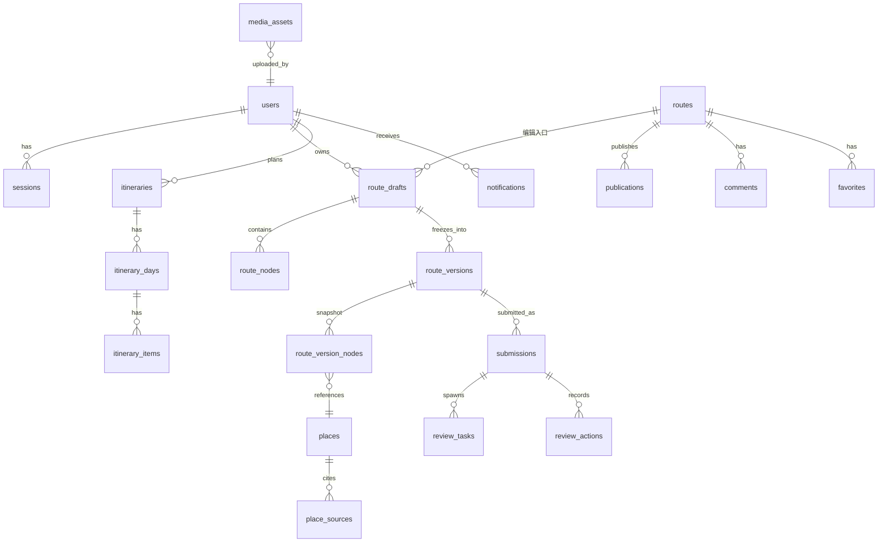

# 数据模型与状态机

> 数据库：PostgreSQL 16。所有表带 `id (uuid)`、`created_at`、`updated_at`。
> 原则：**对外可见的永远是某个不可变版本**；状态字段分开存，不共用一个 `status`。

---

## 1. 实体关系



---

## 2. 表结构

### 2.1 身份

**users**

| 字段 | 类型 | 说明 |
|---|---|---|
| id | uuid | 主键 |
| username | citext unique | 登录名，也是主页展示名 |
| email | citext unique null | 可选 |
| password_hash | text | Argon2id |
| role | text | `user` / `editor` / `admin` |
| bio | text | 个人简介 |
| status | text | `active` / `disabled` |

**sessions**：`id`、`user_id`、`refresh_hash`、`expires_at`、`revoked_at`。

### 2.2 地点与文化资料

**places**

| 字段 | 说明 |
|---|---|
| name / alias | 名称 |
| lat / lon / crs | 坐标，默认 `OGC:CRS84` |
| district | 长沙的区 |
| summary | 一段话介绍 |
| culture_tags | 数组：`历史`/`非遗`/`民俗`/`建筑`/`文学`/`红色`… |
| open_hours | 文本 + `verified_at` |
| status | `draft` / `verified` |

**place_facts**：`place_id`、`claim`（一条可核验的说法）、`confidence`（`verified`/`likely`/`unverified`）、`source_id`。

**place_sources**：`title`、`url`、`publisher`、`accessed_at`、`license`。

> 硬规则：`confidence != verified` 的事实，前端必须显示「待核实」，不得写成确定结论。

### 2.3 路线与版本

**routes**：一条路线的稳定身份，跨版本不变。

| 字段 | 说明 |
|---|---|
| id | 主键 |
| slug | 短链用 |
| author_id | 唯一作者 |
| channel | `official`（平台精选）/ `user`（用户投稿） |
| title / summary / cover_asset_id | 展示信息 |
| theme_tags | 文化主题 |
| duration_minutes | 建议时长 |
| budget_range | `{min,max,currency}` |
| status | `draft` / `published` / `unpublished` / `archived`（由 publication 派生，仅作读取缓存） |

**route_drafts**

| 字段 | 说明 |
|---|---|
| id | 主键 |
| route_id | 属于哪条路线 |
| owner_id | 作者 |
| state | `EDITING` / `SUBMITTED_LOCKED` / `APPROVED_LOCKED` / `ARCHIVED` |
| lock_version | 乐观锁，每次 PATCH +1 |
| base_version_id | 从哪个版本 fork 出来的 |

**route_nodes**：`draft_id`、`place_id`、`position`、`stay_minutes`、`transport`、`note`、`price_min`、`price_max`。

**route_versions**（不可变）

| 字段 | 说明 |
|---|---|
| id | 主键 |
| route_id / draft_id | 来源 |
| version_no | 递增 |
| snapshot | JSONB，整条路线的快照 |
| content_hash | `sha256(canonical_json(snapshot))` |
| created_by | 谁冻结的 |

**route_version_nodes**：为查询方便而从 snapshot 展开的副本（只读）。

### 2.4 审核与发布

**submissions**

| 字段 | 说明 |
|---|---|
| id / route_id / version_id | 投稿对象 |
| submitted_by | 作者 |
| state | `PENDING_REVIEW` / `CHANGES_REQUESTED` / `REJECTED` / `APPROVED` / `WITHDRAWN` / `SUPERSEDED` |
| note | 作者附言 |

**review_tasks**

| 字段 | 说明 |
|---|---|
| id / submission_id | 对应投稿 |
| state | `OPEN` / `CLAIMED` / `COMPLETED` / `CANCELLED` |
| assignee_id | 领取人 |
| lease_expires_at | 领取租约，超时自动回 OPEN |
| completed_action | `approve` / `request_changes` / `reject` |

**review_actions**：`task_id`、`actor_id`、`action`、`reason`、`created_at`。

**publications**

| 字段 | 说明 |
|---|---|
| id / route_id | 一条路线一个 current |
| version_id / content_hash | 发布的精确版本 |
| state | `PUBLISHED` / `UNPUBLISHED` / `ARCHIVED` |
| published_by / published_at / unpublished_reason | 追溯 |

### 2.5 行程

**itineraries**：`id`、`user_id`、`city`、`days`、`people`、`budget_total`、`preferences`、`state`、`visibility`、`share_token`。

**itinerary_days**：`itinerary_id`、`day_index`、`date`（可空）、`summary`。

**itinerary_items**：`day_id`、`order`、`place_id`、`start_time`（可空）、`stay_minutes`、`transport`、`price_min/max`、`confidence`、`source_ids[]`、`note`。

**plan_runs**：`id`、`itinerary_id`、`state`、`input_hash`、`model`、`prompt_version`、`cost`、`error_code`。

**agent_steps**：`run_id`、`agent`（researcher/planner/critic/verifier）、`status`、`output_digest`、`duration_ms`。

### 2.6 社区与运营

**comments**：`route_id`、`user_id`、`body`、`pinned`、`status`（`visible`/`hidden`）。
**favorites**：`user_id` + `route_id` 唯一。
**notifications**：`user_id`、`type`、`payload`、`read_at`。
**audit_logs**：`actor_id`、`action`、`object_type`、`object_id`、`before_hash`、`after_hash`、`reason`、`request_id`、`ip_hash`、`created_at`。
**media_assets**：`owner_id`、`object_key`、`mime`、`size`、`checksum`、`zone`（`quarantine`/`clean`）、`scan_state`、`width/height`。

---

## 3. 四套状态机

### 3.1 route_drafts

```
EDITING ──submit──▶ SUBMITTED_LOCKED ──approve──▶ APPROVED_LOCKED
   │                     │                            │
   │                     └──request_changes/reject──▶ EDITING（新建草稿替代，旧草稿 SUPERSEDED）
   │
   └──archive──▶ ARCHIVED
```

- `SUBMITTED_LOCKED` 期间作者不能改内容，只能撤回（`WITHDRAWN` 后回到 `EDITING`）。
- `APPROVED_LOCKED` 之后要改，必须 fork 新草稿，`base_version_id` 指向被批准的版本。

### 3.2 submissions

```
PENDING_REVIEW ──┬── approve ──────────▶ APPROVED
                 ├── request_changes ───▶ CHANGES_REQUESTED
                 ├── reject ────────────▶ REJECTED
                 ├── author withdraw ───▶ WITHDRAWN
                 └── 新投稿产生 ────────▶ SUPERSEDED
```

- 任何终态都不能再流转。
- `SUPERSEDED` 只由「同一草稿产生新投稿」触发。

### 3.3 review_tasks

```
OPEN ──claim──▶ CLAIMED ──decide──▶ COMPLETED
  ▲                │
  └──release/租约过期──┘
OPEN/CLAIMED ──投稿撤回──▶ CANCELLED
```

- 租约默认 30 分钟，过期由 worker 扫回 `OPEN`。
- 同一投稿同一时间只能有一个 `CLAIMED` 任务（唯一索引保证）。

### 3.4 publications

```
(不存在) ──publish──▶ PUBLISHED ──unpublish──▶ UNPUBLISHED
                          ▲                        │
                          └────── republish ───────┘
PUBLISHED/UNPUBLISHED ──archive──▶ ARCHIVED
```

- 发布必须匹配 `version_id + content_hash`，不匹配 409。
- 下线要写 `unpublished_reason`，并让缓存失效；缓存失败时宁可让前台 404。

### 3.5 itineraries

```
DRAFT ──enqueue──▶ GENERATING ──ok──▶ READY
                        └──fail──▶ FAILED
READY ──convert──▶ (生成 route_draft，不改行程本身)
```

---

## 4. 并发与一致性

| 场景 | 机制 |
|---|---|
| 两个人同时编辑草稿 | `If-Match: lock_version`，不匹配返回 412 |
| 两个审核员同时领取 | `UPDATE ... WHERE state='OPEN' RETURNING`，只有一个成功 |
| 重复提交/重复发布 | `Idempotency-Key`，同 key 返回首次结果 |
| 发布时版本被替换 | 比对 `content_hash`，不一致 409 |
| 下线与缓存 | 先改库再删缓存；删缓存失败记告警并让读路径 fail-closed |

---

## 5. 索引与约束（最低要求）

- `routes(status, channel)`、`route_versions(route_id, version_no)` 唯一
- `submissions(version_id)` 唯一（一个版本只能投一次）
- `review_tasks(submission_id) WHERE state IN ('OPEN','CLAIMED')` 部分唯一
- `publications(route_id) WHERE state='PUBLISHED'` 部分唯一
- `comments(route_id, pinned) WHERE pinned` 部分唯一（每条路线最多一条置顶）
- `favorites(user_id, route_id)` 唯一
- `audit_logs(created_at)`、`itineraries(user_id)`

---

## 6. 迁移约定

- 迁移文件由 **P3 一人**生成和合并，其他人不许新增迁移
- 命名：`YYYYMMDD_HHMM_<动词>_<对象>.py`
- 每个迁移必须能在**空库**和**上一版本库**上重放成功，CI 会检查
- 破坏性改动（删列/改类型）必须先加新列、回填、再删旧列，分两个 PR
