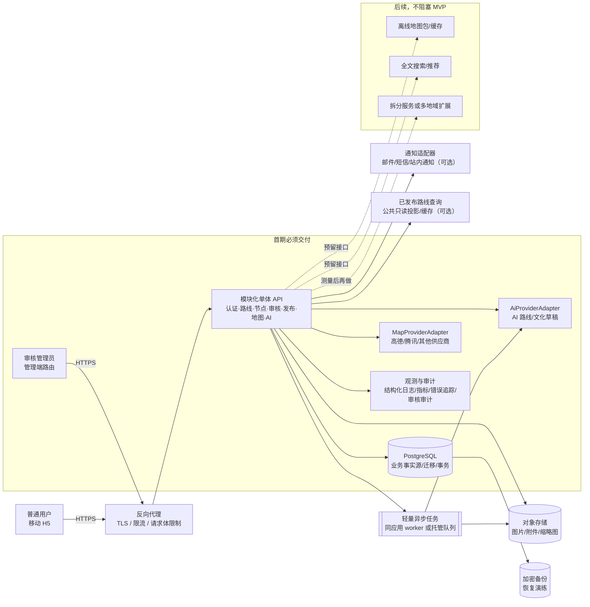
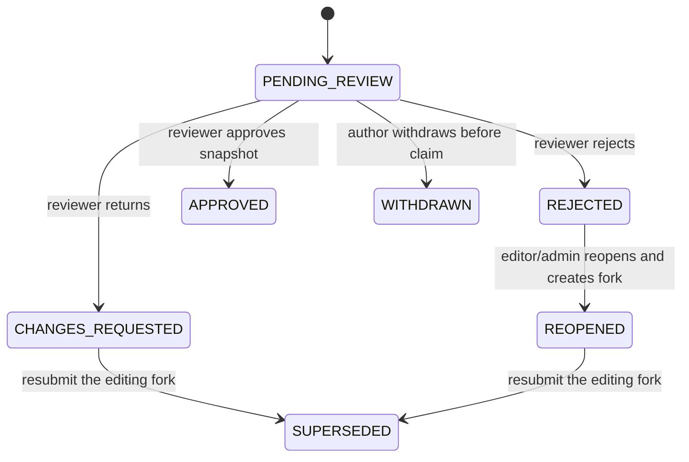
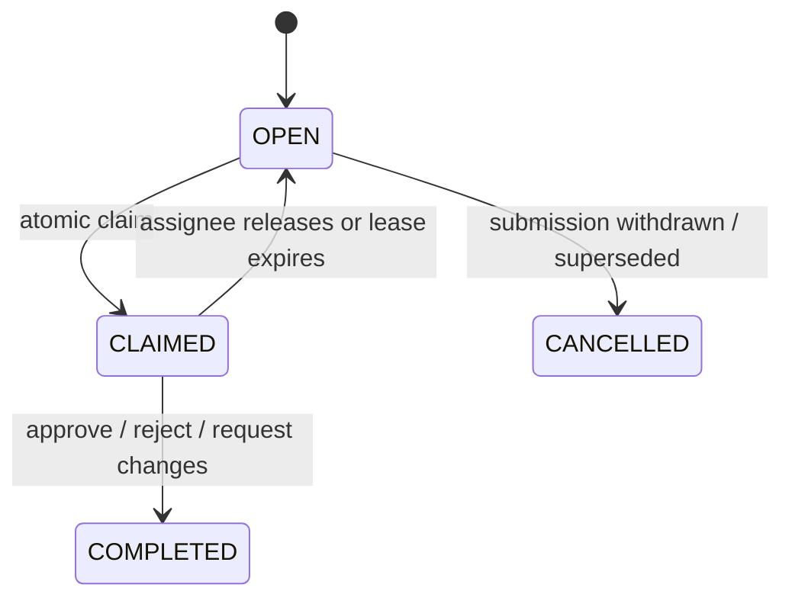
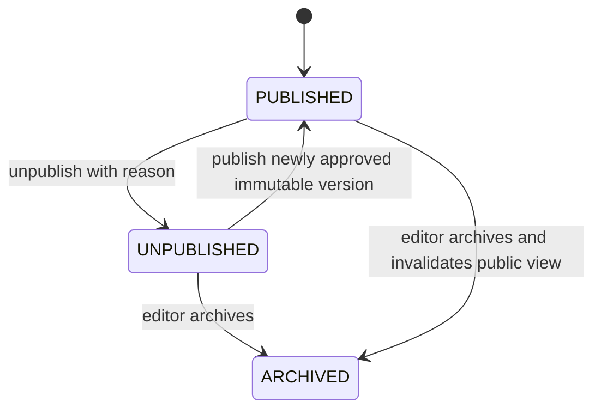
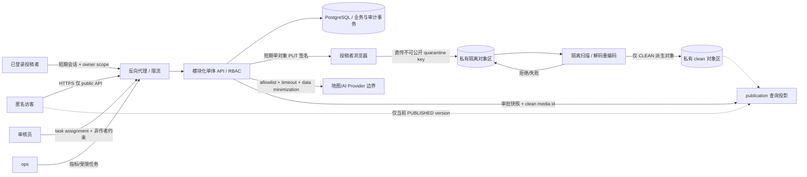

# CulturalWalk 文创路线平台：Vibe Coding 底层架构与开发范式

> **架构基线**：v0.1（面向首个国内低成本公网试点）  
> **编写时间**：2026-10-14（Asia/Shanghai）  
> **适用范围**：新建的独立 CulturalWalk 平台；不是 `travel-planner-rebuild-v1/` 的能力声明，也不是对旧项目的直接升级方案。  
> **阅读标记**：**MUST（必须）**、**SHOULD（应当）**、**LATER（后续）**；“事实”是已有证据，“假设”需产品/技术负责人确认，“待验证”必须在试点前用测试、供应商文档或合规意见确认。

---

## 1. 执行摘要：先做一个可审核、可发布的路线产品

### 1.1 已落地的架构决策

| 决策 | 结论 | 级别 | 依据与边界 |
|---|---|---|---|
| 首发终端 | **移动 Web/H5 优先**，响应式布局；管理员使用同一平台的管理端路由 | MUST | 已确认的产品决策；不先做原生 App/小程序 |
| MVP | 路线浏览/节点查看/地图定位与导航入口；用户提交路线；管理员审核、退回修改、发布/下线 | MUST | 已确认的业务边界；“导航”首期指路线顺序、地图展示和受支持的导航跳转，不宣称自建道路最短路算法 |
| 内容来源 | 文化节点、路线和说明有来源、作者与审核记录；AI 只产生草稿 | MUST | AI 输出不可信；人工确认和审核通过是发布前硬门槛 |
| 后端形态 | **模块化单体（modular monolith）**：一个可部署应用、清晰领域边界、模块内部封装 | MUST | 8 人协作需要边界，但公网试点不值得承担微服务运维成本 |
| 数据 | PostgreSQL 为事实源；对象存储保存图片/附件；轻量异步任务用于 AI、媒体处理和通知 | MUST/SHOULD | 交易状态与审核记录必须可追溯；队列不是跨服务事件总线 |
| 外部服务 | 地图和 AI 均使用可替换 Provider Adapter；密钥不下发到浏览器 | MUST | 避免供应商锁定、便于国内合规和成本切换 |
| 离线 | 本期不做离线地图/离线包；数据和适配器保留离线包扩展点 | LATER | 已确认的延期决策；不要用“PWA 缓存页面”冒充离线地图 |
| 部署 | 单地域、单应用实例起步，反向代理 TLS，备份数据库；按量扩容前先测量 | MUST | 低成本国内公网试点；不引入 Kubernetes、服务网格或自建复杂事件平台 |
| 旧项目 | 仅作为交互和失败边界参考；新平台使用独立目录、独立数据模型、独立部署 | MUST | 现有项目是本机演示，不是路线众创平台基础设施 |

### 1.2 不能由本文件承诺的事项

- **事实边界**：本文件是架构与开发范式，不代表任何 API、地图数据、AI 服务、云资源或合规备案已经开通。
- **待验证**：地图服务的商用/公网配额、导航跳转条款、瓦片和 POI 数据授权、AI 供应商的数据保留策略、国内云厂商价格、ICP/公安备案及个人信息处理要求，必须由采购、法务和运维在试点前逐项确认。
- **内容边界**：模型生成的文化史实、开放时间、商户关系、路线安全提示都必须由人或可靠来源校验，不得因为模型“看起来合理”而发布。

---

## 2. 软件架构设计依据与约束矩阵

本节把“为什么这样设计”与“目前知道什么”分开，避免 Vibe Coding 把推测当事实。

| 依据类别 | 可核查证据 | 形成的约束/结论 | 状态 |
|---|---|---|---|
| 会议/用户已确认决策 | 本任务确认：移动 Web/H5；MVP 为浏览/导航、用户提交、管理员审核发布；离线后置；8 人分两组各 4 人；国内低成本公网试点；AI 必须人工确认 | 需求优先级和非目标以本文件第 1 节为准；任何新增大能力必须更新 ADR 和验收标准 | **事实** |
| 现有代码审计 | `travel-planner-rebuild-v1/README.md:1-9, 28-32, 44-46, 65-67` 明确项目是本机可运行的旅行规划复刻演示；`travel-planner-rebuild-v1/docs/PROJECT_CONTRACT.md:68-70` 规定仅监听 `127.0.0.1`；`PROJECT_CONTRACT.md:16-18` 明确第一阶段不含账号、社区审核等；`项目本尊/` 实查只有 `.DS_Store` | 旧项目可复用交互经验/边界教训，**不能**画成新平台、不能宣称已有账号、审核、路线库或公网能力 | **事实** |
| 旧项目技术参考 | `travel-planner-rebuild-v1/backend/` 为 Python 标准库服务，前端是原生 HTML/CSS/JS；`README.md:46` 说地图连线不是道路导航 | 新平台允许使用更适合公网的框架，但要保留“顺序连线不冒充最短路径”的诚实表达 | **事实** |
| 开源/GitHub/许可证证据 | 2026-10-14 用 GitHub API 检查仓库元数据及仓库 LICENSE 文件；详见第 16 节 | 依赖要锁版本、保留 NOTICE、在 CI 做许可证扫描；仓库活跃不等于未来维护承诺；地图代码许可不等于瓦片/POI 数据许可 | **事实（时间快照）** |
| 公网与国内合规 | 产品预期为国内公网低成本试点；个人信息保护、网络和数据安全义务取决于处理数据、主体、地域和运营方式 | 默认最小化个人信息、TLS、密钥托管、审计、删除/导出流程；ICP备案/许可证、公安备案、PIPL/CSL/DSL适用性请法务确认 | **事实 + 待验证** |
| 8 人协作 | 已确认两组各 4 人，按业务模块共建一个产品 | 按领域切分写边界，而非“前端组/后端组”互相修改；接口先行、PR 集成、单一迁移负责人 | **事实** |
| Vibe Coding 工程实践 | 需求变化快、AI 可生成代码和内容，但上下文容易漂移、边界容易被覆盖 | 小步任务、上下文文件、契约测试、人工审查、可回滚迁移、禁止凭模型输出宣布完成 | **工程假设，需持续验证** |
| 成本目标 | “低成本”已确认，但没有选定云厂商、并发量和预算数 | 采用单体、单地域、按量付费和可关闭异步任务；月度预算和容量基线在试点前压测确认 | **假设/待验证** |

### 2.1 约束优先级

1. **MUST**：用户安全、人工审核门槛、数据和密钥不泄露、状态机不越权、API 契约可回归。
2. **SHOULD**：低成本、可观测、可替换 Provider、模块边界和小 PR；出现冲突时先保证数据正确性和合规。
3. **LATER**：离线地图、实时多人协作编辑、复杂推荐/搜索、道路级优化、微服务拆分、Kubernetes、事件总线。

---

## 3. 总体软件架构

### 3.1 Mermaid 总体架构图



### 3.2 图中组件职责

| 组件 | 职责 | 明确不负责 |
|---|---|---|
| 移动 H5 | 浏览路线、查看节点、定位、跳转导航、提交路线、查看审核结果 | 不保存供应商密钥；不自行判断 AI 内容可信度 |
| 管理端 | 待审队列、差异对比、来源核验、退回/拒绝/通过、发布/下线、审计查询 | 不绕过后端状态机直接改数据库 |
| 反向代理 | HTTPS、静态资源、基础限流、压缩、请求大小限制、健康检查入口 | 不实现业务权限；不把内部管理接口暴露为匿名接口 |
| 模块化单体 | 领域规则、授权、事务、API、Provider 编排 | 不把每个模块拆成独立网络服务 |
| PostgreSQL | 用户、节点、路线版本、提交、审核动作、发布记录、审计事实 | 不存大图片；不作为跨模块任意读写共享表 |
| 对象存储 | 原图/缩略图/文档，病毒扫描和尺寸限制后的对象 | 不放明文密钥；不允许任意公共写入 |
| 异步任务 | AI 草稿、缩略图、通知、重试和限时任务 | 不改变发布状态；发布必须由授权人同步确认并产生审计记录 |
| Provider Adapter | 统一内部接口、超时、重试、配额、脱敏、供应商错误映射 | 不把供应商响应未经校验直接写成发布内容 |
| 观测/审计 | 技术日志、指标、错误、不可篡改或受保护的审核动作记录 | 不把个人隐私写进普通日志 |

### 3.3 为什么不用微服务、事件总线和 Kubernetes

- **模块化单体而不是微服务（MUST）**：MVP 的一致性边界是“提交→审核→发布”，调用链短、团队只有 8 人、低成本公网试点需要少量运维对象。单体内可用模块接口和依赖规则隔离，先用进程内调用/数据库事务解决问题。
- **不引入事件总线（MUST，除非指标证明需要）**：审核通知、缩略图和 AI 草稿是少量异步任务，用任务表、进程内 worker 或托管队列即可。不要为了“架构先进”引入 Kafka/RabbitMQ 的部署、重放和一致性成本。
- **不引入 Kubernetes（MUST）**：单地域、早期流量和单体部署不需要调度集群。先使用反向代理 + 一个应用容器/进程 + 托管 PostgreSQL/对象存储；当有明确的容量、故障隔离或合规证据后再评估容器编排。
- **允许未来演进（SHOULD）**：模块只依赖端口/接口，不依赖别的模块内部 ORM；当某模块需要独立扩展时可以先抽出适配器，再决定是否独立部署，不提前支付微服务税。

---

## 4. 独立仓库/项目结构

新项目建议为单独仓库（名称示例 `culturalwalk-platform`），不在 `travel-planner-rebuild-v1/` 中追加文件。

```text
culturalwalk-platform/
├── apps/
│   └── web-h5/                         # 用户 H5 + 管理端路由（可拆独立构建）
│       ├── src/pages/                  # browse、route-detail、submit、admin-review
│       ├── src/features/               # 按领域组织 UI 与状态
│       ├── src/shared/                 # 设计系统、请求客户端、错误处理
│       └── tests/                      # 组件/移动端 smoke
├── services/
│   └── api/                            # 一个部署单元：模块化单体
│       ├── app/main.py                 # 组装路由、配置和生命周期
│       ├── modules/
│       │   ├── identity/               # 用户、角色、会话、权限
│       │   ├── nodes/                  # 文化节点、来源、版本
│       │   ├── routes/                 # 路线草稿、版本、发布查询
│       │   ├── submissions/            # 投稿、审核任务、审核动作
│       │   ├── navigation/             # 坐标、地图和导航 Provider 端口
│       │   ├── ai_drafting/            # AI 草稿任务、提示版本、结果校验
│       │   ├── media/                  # 上传、扫描、缩略图、授权
│       │   └── audit/                  # 审计事件、运营查询
│       ├── db/migrations/              # 仅由迁移负责人生成/审查
│       └── tests/                      # domain、contract、integration
├── packages/
│   ├── sdk-generated/                  # 从 docs/api/openapi.yaml 生成；禁止手改
│   └── ui/                             # 可选：H5 与管理端共享无业务组件
├── infra/
│   ├── docker/                         # 本地/试点镜像，不含密钥
│   ├── proxy/                          # Nginx/Caddy 配置模板
│   └── deploy/                         # 备份、回滚、健康检查 runbook
├── docs/
│   ├── PROJECT_CONTEXT.md              # 稳定上下文和非目标
│   ├── ARCHITECTURE.md                 # 本文或其发布版
│   ├── api/openapi.yaml                # API 唯一事实源
│   ├── adr/                            # ADR-0001...
│   ├── runbooks/                       # 发布/回滚/备份/事故
│   └── moderation/                     # 审核规则、来源与申诉策略
├── .github/workflows/ci.yml
├── AGENTS.md                           # AI 协作边界
├── CONTRIBUTING.md
├── pyproject.toml / package.json
└── README.md
```

- **MUST**：每个模块拥有自己的领域服务、校验、仓储接口和测试；跨模块只调用公开服务接口或应用层端口。
- **MUST**：数据库迁移集中审查，禁止多个分支同时自由改同一迁移编号。
- **SHOULD**：`features/` 与 `modules/` 使用同一业务词汇；禁止仅按“controllers/services/utils”平铺所有文件。
- **LATER**：当管理端体量显著增大时才拆为 `apps/admin`；这不改变后端模块边界。

---

## 5. 模块边界与业务责任

| 领域模块 | 核心实体/不变量 | 对外提供 | 明确不拥有 |
|---|---|---|---|
| `identity` 身份与访问 | User、Role、Session；角色变更可追溯；默认拒绝 | 当前用户、登录/登出、RBAC 判定 | 路线内容、审核结论 |
| `nodes` 文化节点 | Node、NodeVersion、Source；地点与内容来源可追溯 | 查询已发布节点、编辑候选节点 | 投稿最终发布权 |
| `routes` 路线 | RouteDraft、RouteVersion、RouteNode；版本不可变、排序稳定 | 草稿保存、版本比较、公共已发布查询 | 审核动作、AI 自行发布 |
| `submissions` 投稿与审核 | Submission、ReviewTask、ReviewAction；状态机只允许合法转换 | 投稿、待审队列、退回/拒绝/通过 | 地图供应商实现、模型调用 |
| `publication` 发布 | Publication、Visibility；只有审核通过版本可以发布 | 发布、下线、公共读取 | 编辑未审核草稿 |
| `navigation` 地图/导航 | 坐标精度、地理编码、路线入口；供应商失败可降级 | 地图配置、定位、导航 deeplink/路线摘要 | 文化内容真伪判断 |
| `ai_drafting` AI 草稿 | GenerationRun、PromptVersion、provenance；输出永远是候选草稿 | 生成、重试、校验和人工确认清单 | 绕过审核、直接写发布表 |
| `media` 媒体 | MediaAsset、License、ScanStatus；上传者和授权声明 | 受限上传、扫描、缩略图、授权信息 | 任意公网上传/任意 HTML |
| `audit` 运营审计 | AuditEvent；主体、对象、前后摘要、时间、请求 ID | 审计查询、导出、告警 | 普通业务日志中的隐私复制 |

依赖方向建议：`routes → nodes`、`submissions → routes`、`publication → submissions/routes`、`ai_drafting → routes/nodes`（通过应用端口）、`navigation` 不反向依赖内容审核。任何循环依赖必须先写 ADR。

---

## 6. API 与 Schema 所有权

### 6.1 契约规则

1. **MUST**：仓库根目录 `docs/api/openapi.yaml` 是 HTTP 契约唯一事实源；`packages/sdk-generated/` 仅存生成产物，不承载第二份契约。每个 endpoint 标注模块 owner、鉴权要求、错误码和版本。
2. **MUST**：数据库表是模块内部实现，不把 ORM 模型直接当公共 API schema；响应 DTO 由 owner 维护。
3. **MUST**：破坏性变更升级 `/api/v1` → `/api/v2` 或执行兼容窗口；先改契约和消费者测试，再实现。
4. **SHOULD**：从 OpenAPI 生成 TypeScript 类型/客户端，但生成文件不手改；后端 Pydantic 模型做输入输出校验。
5. **MUST**：统一错误包：`{ "error": { "code": "...", "message": "...", "request_id": "...", "details": [] } }`；对外消息不含堆栈、密钥、SQL 和上游原文。
6. **MUST**：写操作支持 `Idempotency-Key`（至少投稿、发布、上传确认）；服务端记录 key、调用者和响应摘要。

### 6.2 MVP API 草案（接口 owner 必须在实现前冻结）

| 方法与路径 | owner | 用途 | 权限/契约 |
|---|---|---|---|
| `GET /api/v1/routes` | publication | 分页浏览公开路线 | 匿名、限流；只投影当前 `PUBLISHED` publication；忽略任何 `status` 查询参数，调用者不能选择草稿/归档 |
| `GET /api/v1/routes/{route_id}` | publication | 已发布路线及固定版本 | 匿名；当前无 active publication 一律 404，不透露草稿存在 |
| `POST /api/v1/route-drafts` | routes | 创建草稿 | 登录用户；owner=当前用户 |
| `PATCH /api/v1/route-drafts/{id}` | routes | 更新工作草稿 | 登录且本人；必须带 `If-Match: lock_version`，仅 `EDITING` 可写 |
| `POST /api/v1/route-drafts/{id}/submit` | submissions | 冻结快照并创建投稿/审核任务 | 本人；`Idempotency-Key`；返回 submission_id、snapshot_hash、状态 |
| `POST /api/v1/submissions/{id}/withdraw` | submissions | 投稿撤回 | 投稿人；仅未领取任务；领取中先由 reviewer release |
| `POST /api/v1/route-drafts/{id}/fork` | routes | 从锁定快照创建新的编辑副本 | contributor 本人，或具 `route:write` 范围的 editor/admin；源状态仅 `SUBMITTED_LOCKED/APPROVED_LOCKED`；需 `If-Match`/`Idempotency-Key` |
| `POST /api/v1/admin/submissions/{id}/reopen` | submissions | 明确批准被拒投稿重新编辑 | editor/admin；仅 `REJECTED`、理由必填、无活动新 attempt；锁定并复制被拒版本为 `EDITING` fork；需 `If-Match`/`Idempotency-Key` |
| `POST /api/v1/submissions/{id}/resubmit` | submissions | 修改后再次投稿 | 投稿人；仅 `CHANGES_REQUESTED` 或 `REOPENED`，必须提交本人 `EDITING` fork 的新 hash，并带 `If-Match`/`Idempotency-Key` |
| `GET /api/v1/me/submissions` | submissions | 查看自己投稿和意见 | 登录且仅本人对象 |
| `GET /api/v1/admin/review-tasks` | submissions | 待审/已领取任务列表 | reviewer/editor；服务端按任务范围过滤 |
| `POST /api/v1/admin/review-tasks/{id}/claim` | submissions | 原子领取任务 | reviewer；不得领取自己作者/共同作者的投稿 |
| `POST /api/v1/admin/review-tasks/{id}/release` | submissions | 释放未完成任务 | 领取人或受限 ops 重试路径；必须审计 |
| `POST /api/v1/admin/review-tasks/{id}/request-changes` | submissions | 退回并写结构化理由 | 当前领取 reviewer/editor；非投稿作者 |
| `POST /api/v1/admin/review-tasks/{id}/reject` | submissions | 拒绝投稿 | 当前领取 reviewer/editor；非投稿作者；理由必填 |
| `POST /api/v1/admin/review-tasks/{id}/approve` | submissions | 核准固定快照 | 当前领取 reviewer/editor；非投稿作者；只生成可发布资格 |
| `POST /api/v1/admin/publications` | publication | 发布已核准快照 | editor/admin；二次确认、版本/hash 精确匹配、幂等 key |
| `POST /api/v1/admin/routes/{id}/unpublish` | publication | 下线路线 | editor/admin；理由必填、审计和缓存失效须完成 |
| `POST /api/v1/media/upload-intents` | media | 创建短时上传意图 | 登录用户；校验 owner、配额、声明 MIME/大小/授权；返回隔离桶单对象预签名 URL |
| `POST /api/v1/media/{id}/confirm` | media | 幂等确认对象已上传 | 意图 owner；`Idempotency-Key`；校验 key/size/checksum 后进入 `QUARANTINED` |
| `GET /api/v1/media/{id}` | media | 查询上传/扫描状态 | owner；关联投稿中的 reviewer；ops 仅状态元数据 |
| `DELETE /api/v1/media/{id}` | media | 删除未引用媒体 | owner 或受限 media worker；已被发布版本引用不可硬删 |
| `POST /api/v1/route-drafts/{id}/ai-draft` | ai_drafting | 异步生成候选内容 | 登录且为草稿 owner；202 返回 `run_id`/`QUEUED`；配额和限长 |
| `GET /api/v1/ai-runs/{id}` | ai_drafting | 查询生成状态与字段候选 | 发起人/草稿 owner；关联投稿范围内 reviewer |
| `POST /api/v1/ai-runs/{id}/cancel` | ai_drafting | 请求取消生成 | 发起人/owner；合作式取消并审计 |
| `GET /api/v1/map/config` | navigation | 返回不含秘密的地图配置 | 匿名受限；仅核准公开配置 |
| `POST /api/v1/navigation/resolve` | navigation | 地理编码/导航入口 | 登录/限流；仅白名单 Provider，坐标基准显式声明 |

外部对象存储仅由浏览器使用 upload-intent 返回的短期、单对象、限定方法/长度/内容类型的 URL 直传隔离区；API 不代理用户任意 URL。OpenAPI 在 `docs/api/openapi.yaml` 定义每个 endpoint 的 schema、错误、scope、幂等和响应码；生成命令为 `openapi-typescript docs/api/openapi.yaml -o packages/sdk-generated/api.ts`，生成文件禁止手改。

### 6.3 Schema 最小示例

```json
{
  "schema_version": "route.v1",
  "route_id": "rt_01J...",
  "version": 3,
  "title": "老城文脉步行线",
  "summary": "由已核验文化节点组成的半日路线",
  "nodes": [
    {
      "node_id": "nd_01J...",
      "order": 1,
      "title": "文化节点名称",
      "location": {"lat": 28.0001, "lon": 112.0001, "crs": "OGC:CRS84", "datum": "WGS84", "precision": "provider", "source": "verified-provider"},
      "content_status": "human_verified",
      "source_refs": ["src_123"]
    }
  ],
  "provenance": {
    "author_id": "usr_...",
    "ai_assisted": true,
    "ai_run_id": "air_...",
    "field_decisions": [{"path": "summary", "decision": "ACCEPT", "actor_id": "usr_...", "at": "2026-10-14T09:00:00Z", "before_hash": "...", "after_hash": "..."}]
  }
}
```

`content_status` 与 `source_refs` 是发布前必填条件。若有 AI 候选字段，每个被采纳字段须有 ACCEPT/EDIT 决策及 actor/time/before_hash/after_hash 审计；未决字段不可进入版本快照。客户端不得根据 `ai_assisted=true` 自动渲染“权威”徽章。

---

## 7. 数据模型与路线状态机

### 7.1 核心表与所有权

| 表/聚合 | 关键字段（示例） | owner | 约束 |
|---|---|---|---|
| `users` | `id`, `status`, `consent_version`, `created_at`, `deleted_at` | identity | 删除采用软删除/匿名化策略，按保留政策执行 |
| `user_roles` | `user_id`, `role`, `granted_by`, `granted_at`, `revoked_at` | identity | 角色变更必写 audit |
| `cultural_nodes` | `id`, `current_version_id`, `visibility`, `owner_id` | nodes | 已发布版本不可原地覆盖 |
| `node_versions` | `node_id`, `content`, `source_refs`, `review_status`, `created_by` | nodes | 内容版本不可变；位置精度单独记录 |
| `route_drafts` | `id`, `owner_id`, `working_version`, `status`, `lock_version`, `fork_of_version_id`, `source_hash` | routes | 乐观锁防止覆盖；fork 来源/hash 可追溯，源快照不回写 |
| `route_versions` | `route_id`, `version`, `snapshot_json`, `content_hash`, `created_by` | routes | 投稿使用快照，审核运行在固定版本；版本不可变 |
| `route_nodes` | `route_version_id`, `node_id`, `order_index`, `visit_note` | routes | 同一版本内 order 唯一且从 1 连续 |
| `submissions` | `id`, `route_version_id`, `submitter_id`, `state`, `editing_fork_id`, `submitted_at` | submissions | 状态只能由状态机服务修改；editing fork 与源快照绑定 |
| `review_tasks` | `id`, `submission_id`, `assignee_id`, `state`, `due_at` | submissions | 领取/转派/释放有权限和审计 |
| `review_actions` | `id`, `task_id`, `actor_id`, `action`, `reason`, `diff_summary` | submissions/audit | 追加写，禁止更新旧动作 |
| `publications` | `route_id`, `route_version_id`, `published_by`, `published_at`, `unpublished_at` | publication | 仅 approved 版本可发布 |
| `ai_generation_runs` | `id`, `provider`, `model`, `prompt_version`, `input_hash`, `output_json`, `safety_flags` | ai_drafting | 原始输出分级保存，敏感输入脱敏 |
| `media_assets` | `id`, `object_key`, `scan_status`, `license_type`, `uploader_id` | media | 未扫描/未授权不能进入发布版本 |
| `audit_events` | `id`, `request_id`, `actor`, `action`, `object`, `before_hash`, `after_hash`, `created_at` | audit | 追加写、访问受控、定期备份 |

### 7.2 四个正交状态机（互不冒充）

`route_drafts` 描述作者正在编辑的工作副本；`submissions` 描述一次不可变快照的投稿结果；`review_tasks` 描述审核工作分配；`publications` 描述公开版本。它们通过有事务约束的应用服务同步，但各有状态列、转换权限和审计事件，禁止共用一个 status 或用 submission 状态推导 publication。已投稿/已批准的 `route_version` 永久只读；需要修改时只从其固定快照 fork 出新的 `route_draft(EDITING)`，不得把旧 draft 改回可写来伪装版本。

```mermaid
stateDiagram-v2
    [*] --> EDITING
    EDITING --> SUBMITTED_LOCKED: submit snapshot
    SUBMITTED_LOCKED --> SUBMITTED_LOCKED: withdraw / changes requested; fork new EDITING draft
    SUBMITTED_LOCKED --> APPROVED_LOCKED: submission approved
    APPROVED_LOCKED --> APPROVED_LOCKED: POST /route-drafts/{id}/fork; create new EDITING draft
    EDITING --> ARCHIVED: owner archives, no open submission
```









**同步与转换契约（MUST）**

| 命令 | 原子效果/授权 | 失败与并发规则 |
|---|---|---|
| `POST /route-drafts/{id}/submit` | 校验本人 `EDITING` 草稿、来源/授权和无活动投稿；生成不可变 `route_version`/hash、`PENDING_REVIEW` submission、`OPEN` review_task；draft→`SUBMITTED_LOCKED`；同事务写 audit | 要求 `If-Match` 与 `Idempotency-Key`；锁版本冲突 409；相同 key 重放同响应；不同 key 的并发重复投稿由唯一活动 submission 约束拒绝 |
| `POST /submissions/{id}/withdraw` | 投稿人仅在 task=`OPEN` 时撤回；submission→`WITHDRAWN`、task→`CANCELLED`；源 draft 保持 `SUBMITTED_LOCKED`，并创建本人 `EDITING` fork | 事务锁 submission/source draft；`CLAIMED` 时拒绝 409；不删除快照/audit；重复撤回幂等 |
| `POST /route-drafts/{id}/fork` | source draft 为本人或授权 editor/admin 可见的 `SUBMITTED_LOCKED/APPROVED_LOCKED`；锁定源 hash，复制其固定 snapshot，创建新 draft=`EDITING` 并写 `fork_of_version_id/source_hash` | `If-Match`/`Idempotency-Key`；同源仅允许一个活动 editing fork；旧 draft/version 不回写；重复 key 返回同一 fork，hash 冲突 409 |
| `request-changes` | 当前领取人且非投稿作者；task→`COMPLETED`、submission→`CHANGES_REQUESTED`；源 draft 保持锁定并创建 `EDITING` fork，理由写入 review_action | 结构化理由必填；事务锁 task/submission/source；原版本只读；fork 失败则整体回滚 |
| `reject` / `approve` | 当前领取人且非投稿作者；task→`COMPLETED`；submission→`REJECTED` 或 `APPROVED`；approve 仅授权精确 `route_version_id+content_hash` | 条件更新保证任务只能终结一次；旧审批不授权新 hash |
| `POST /admin/submissions/{id}/reopen` | editor/admin、理由必填，仅 `REJECTED` 且无活动 attempt；锁定被拒 hash，submission→`REOPENED`，创建本人可编辑 `route_draft` fork，并追加 review_action/audit | `If-Match`/`Idempotency-Key`；同 route 仅一个活动 fork；已重开或 hash 过期返回 409；旧 submission/version/task 不改写 |
| `POST /submissions/{id}/resubmit` | 投稿人仅可用关联 `editing_fork_id` 的 `EDITING` 草稿；事务生成新 hash/version，旧 submission→`SUPERSEDED`，新 submission=`PENDING_REVIEW`、new task=`OPEN`、fork→`SUBMITTED_LOCKED` | `If-Match`/`Idempotency-Key`；锁 old submission+fork；必须新 hash；旧 task 已终结；同 key 返回同一 attempt，冲突 409 |
| `POST /admin/publications` | editor/admin 指定已 `APPROVED` submission 和完全相同 hash，插入不可变 publication 并更新 route current pointer | 同 route 串行化；DB 只允许一个 current publication；事务后清除旧公开缓存；幂等 key 防双发 |
| `unpublish` | editor/admin 理由必填；current publication→`UNPUBLISHED`，清空 pointer 并写 audit | purge 失败时公共读 fail-closed/绕过缓存并报警，不得成功响应后留下旧公开版 |

`route_drafts.status` 仅允许 `EDITING/SUBMITTED_LOCKED/APPROVED_LOCKED/ARCHIVED`；`submissions.state` 仅允许 `PENDING_REVIEW/CHANGES_REQUESTED/REJECTED/REOPENED/APPROVED/WITHDRAWN/SUPERSEDED`；`review_tasks.state` 仅允许 `OPEN/CLAIMED/COMPLETED/CANCELLED`；`publications.state` 仅允许 `PUBLISHED/UNPUBLISHED/ARCHIVED`。集合互不复用；错误迁移返回稳定 409，成功和拒绝的高风险操作均记 actor、对象、版本/hash、理由与 request_id。`REOPENED` 只表示 editor/admin 已批准重新编辑，不表示内容已通过审核；必须从固定旧 hash fork，重投后才进入新的 `PENDING_REVIEW`。

**发布与公开读取硬规则（MUST）**：公共列表/详情只查询 current pointer 所指、状态 `PUBLISHED` 的不可变 `route_version`；不从 draft 或“最新版本”回退。传 `?status=draft|archived|anything` 均忽略该参数，不扩大结果。下线事务清空 pointer，公共缓存按 route/version 同步失效；MVP 不对单条公开详情设无法同步清除的长 TTL。负例测试必须证明草稿、`PENDING_REVIEW`、已批准但未发布、`UNPUBLISHED`、`ARCHIVED` 均不能从列表/详情/缓存读取；匿名查询未知或未发布 id 返回同形 404。

**硬规则（MUST）**：AI 任务只可写 `ai_generation_runs` 和作者草稿建议；不能调用 `approve`、`publish`、`unpublish`。即使无人审核时自动发布也不属于 MVP。

### 7.3 事务与并发

- 一次提交在同一数据库事务中创建不可变 `route_version`、`submission`、`review_task`、`audit_event` 并锁定 draft；全部成功或回滚。
- `PATCH` 使用 `If-Match/lock_version` 条件更新；审核领取使用行锁、`OPEN→CLAIMED` 条件更新和唯一活动任务约束，防双领取。
- 投稿快照、审核 action、批准 hash、publication version 均不可原地改写；发布必须匹配被批 `route_version_id+content_hash`。
- 改动已提交内容须先退回/撤回，再从固定 `route_version` fork 新 draft；旧 draft、版本、task、submission、audit 保留且不可原地改写。
- `fork`、`reopen`、`resubmit` 均在同一事务中锁定源对象和 `lock_version`；每个源 route/version 最多一个活动 `EDITING` fork，唯一约束防止并发双 fork。
- AI 完成只产生候选；作者采纳后新建 route version，draft 回到 `EDITING`，旧批准永不沿用。
- `Idempotency-Key` 按 caller+operation+key 唯一存储；同请求返回原结果，不同请求体复用同 key 返回 409；保留时长由 ADR 明确并至少覆盖客户端重试窗口。

---

## 8. 身份、RBAC 与审核审计

### 8.1 角色

| 角色 | 能力 | 最小权限原则 |
|---|---|---|
| `visitor` | 浏览公开路线、有限地图查询 | 无个人草稿、无管理 API |
| `contributor` | 创建/编辑自己的草稿、投稿、查看自己的审核意见 | 不能审核自己的投稿，不能发布 |
| `reviewer` | 领取审核任务、退回、拒绝、通过 | 不能修改原作者快照；通过动作留痕 |
| `editor` | 管理内容、发布/下线、处理申诉 | 不能读取不必要的原始个人信息 |
| `admin` | 账号、角色、策略和紧急下线 | 仅少数人员；高风险操作二次确认 |
| `ops` | 健康、指标、备份、受限任务重试 | 只读脱敏运行元数据；默认看不到正文/隐私，不可改业务状态 |
| `audit-reader` | 审计查询/脱敏导出 | 独立只读权限；查询和导出留痕；不能写业务对象或审计事件 |
| `system` | 单一服务账号执行指定后台任务 | 精确 job-type/object-id scope；无交互登录、无审批/发布/下线权限 |

- **MUST**：后端每次请求在服务端执行 RBAC；前端隐藏按钮只是体验，不是安全边界。
- **MUST**：reviewer 与 contributor 的关系校验防止自审；管理员授予角色须记录授权人和过期/撤销时间。
- **SHOULD**：登录采用短期 access token + 轮换 refresh token（HttpOnly、Secure、SameSite）；若采用 cookie，启用 CSRF token。不要使用固定万能验证码。
- **待验证**：试点是否采用受邀账号、手机号/邮箱实名验证或第三方登录；在没有可靠短信供应商时，宁可使用受邀测试账号，也不能在公网部署 `1234` 等通用验证码。

### 8.1.1 按端点与对象的授权矩阵（默认拒绝）

| 端点/动作 | 允许主体 | 强制对象/任务范围 | 默认拒绝及负例 |
|---|---|---|---|
| draft create/update/submit | contributor | `owner_id == current_user`；update 要求 `EDITING+lock_version` | visitor、他人 ID、`APPROVED_LOCKED` 均拒绝；不能靠猜 ID 访问 |
| own submission list/detail | contributor | `submitter_id == current_user` | 他人投稿、意见、附件不可见 |
| review queue/claim/decision | reviewer/editor | task 已分配给本人或可领取；投稿作者/共同作者不得自审 | 未领取者不能决策；作者 self-claim/self-approve 拒绝；终结 task 不可二次通过 |
| publish/unpublish | editor/admin | 指定 route、approved submission、snapshot hash 一致 | reviewer、contributor、ops、system 不能发布；未批 hash、重复并发发布、无理由下线拒绝 |
| audit read/export | audit-reader；admin 仅需时 | 只读、字段脱敏、时间/对象范围；导出单独审计 | ops/reviewer/contributor 无权查全量审计；任何人不可更新/删除事件 |
| ops health/metrics/retry | ops | allowlist 指标和 task ID；限次数/队列，先记录原因 | ops 不可读正文、附件、prompt、凭据，不可改业务状态/审核结论 |
| system/worker | system | 精确 service account + job type + 被授权 run/media/task ID | 无人类登录；禁止通配对象查询、任意 SQL 写业务状态、approve/publish/unpublish |
| public routes | anonymous | current pointer + `PUBLISHED` version | 不可访问 draft/submission/review/quarantine；未知/未发布 id 同形 404 |

所有 API 先认证主体，再按 owner、submitter、task assignee、route/version/hash 在服务层授权；前端隐藏按钮不是边界。权限测试由 endpoint×role×own/other object×claimed/unclaimed/closed task×current/stale version 的 allow/deny 表驱动，必须覆盖 contributor 自审、reviewer 未领取越权、ops 读正文、system 发布、audit-reader 写审计、公开读未发布路线全部失败。

### 8.2 审核与内容安全

**MUST 检查清单**：

1. 文化事实：来源链接/档案/采访记录，无法确认的字段标注“待核实”；
2. 位置和路线：坐标来自可信 Provider 或人工确认，路线时长不由模型伪造；
3. 媒体版权：上传者声明授权，保存许可类型、来源和撤下联系人；
4. 安全与敏感内容：危险地点、私人住宅、未成年人信息、歧视/仇恨/违法内容、广告和冒用官方标识；
5. AI 标记：展示生成/辅助来源和人工确认状态，不把模型当来源；
6. 发布快照：管理员看到的 diff、来源和扫描结果必须与最终发布 hash 一致。

**审核审计字段（至少）**：`request_id`、`actor_id/actor_type`、IP 哈希或受控网络标识、user-agent 摘要、action、object_type/id、before/after hash、理由、策略版本、时间、结果、错误码。普通日志不记录身份证号、完整手机号、token、AI 原始敏感 prompt。

**MUST**：审计表追加写；仅 `audit-reader` 和有明确业务必要的 admin 可查，导出脱敏且单独审计；ops/system/reviewer 无默认全量审计权限。日志和审计分开设置保留期；删除个人账号时保留法律/运营所需的最小不可识别审计记录。

---

## 9. 地图/导航 Provider Adapter

### 9.1 内部端口

```text
MapProvider
  geocode(query, region, timeout) -> PlaceCandidate[]
  reverse_geocode(lat, lng, timeout) -> Address
  route_preview(points, mode, timeout) -> RoutePreview       # 可选，需许可
  navigation_link(points, mode) -> SafeExternalLink
  tile_config() -> PublicMapConfig                           # 不返回秘密
```

- **MUST**：Provider 返回值先经过 schema、坐标范围、精度和超时校验；失败映射为 `MAP_PROVIDER_UNAVAILABLE` 等稳定错误。
- **MUST**：浏览器端只拿受域名/包名限制的公开配置；服务端密钥放环境变量/密钥管理器，禁止打包到 JS。
- **MUST**：在 UI 中区分“点位/访问顺序连线”“供应商路线预览”“外部导航跳转”；没有道路 API 证据不能称“最短路线”。
- **SHOULD**：先实现一个国内 Provider，保留 `MapProvider` 接口和 contract fixture；备选 Provider 只在供应商条款、价格和数据质量核验后接入。
- **LATER**：离线地图包、缓存瓦片、轨迹记录和多供应商自动切换；需重新评估授权、存储和隐私。

### 9.2 坐标基准、轴序与数据许可边界

**内部规范（MUST，发布实现前以 ADR-0013 冻结）**：canonical storage 使用 WGS84 / `OGC:CRS84` 的十进制度；数据库字段明确 `lat`、`lon`、`datum`、`precision`、`source_provider`、`verified_at`。普通 API 使用具名 `{lat, lon, crs:"OGC:CRS84", datum:"WGS84"}` 对象；GeoJSON 坐标数组严格按 `[longitude, latitude]`。拒绝缺 datum、未知 CRS、经纬超界或轴序疑似颠倒的数据；`precision="provider"` 不能代替 datum。

Provider adapter 是唯一转换边界：输入输出先转 canonical，再按被核验供应商接口将其映射到供应商明确要求/返回的 CRS/datum；GCJ-02、BD-09 等偏移坐标不得冒充 WGS84，前端、业务实体和持久化层不散落转换公式。供应商坐标系、合同、可转换范围、精度与商用许可当前均为**待核实**；不得猜测供应商默认为哪种 datum。接入前记录 provider 文档 URL/版本及法务结论；无法确认时禁止地理编码和路线叠加，仅提供人工核实点位/外部导航提示。

**MUST 测试**：固定版本转换库；加入人工确认来源的已知控制点 fixture（输入 datum、期望 canonical、允许误差由 provider 文档确定）、正反向 round-trip、有意经纬交换、边界范围、未知 datum 拒绝、Provider 超时/错误。控制点、误差阈值和供应商能力在接入前填写，当前未验证，不得从互联网抓取未经许可的坐标样本。

Leaflet、MapLibre、OpenLayers 是代码库，不自带可任意商用的中国地图瓦片、POI 或导航数据。瓦片 URL、坐标系、境内测绘合规、缓存和调用配额必须独立核验；不能因为 JavaScript 库开源就复制第三方地图数据。

---

## 10. AI Provider Adapter 与人工确认

```text
AiProvider
  draft_route(input: RouteDraftInput, policy: DraftPolicy) -> DraftSuggestion
  draft_cultural_content(node: NodeInput, policy: DraftPolicy) -> DraftSuggestion
```

### 10.1 异步 run 与字段级采纳契约

`POST /api/v1/route-drafts/{id}/ai-draft` 接受请求后返回 HTTP **202** `{run_id, state:"QUEUED", status_url}`；创建端校验 caller+draft ownership、配额、输入 hash 与 `Idempotency-Key`。同 key 同输入返回原 `run_id`；同 key 不同输入 409。`ai_generation_runs` 保存 `run_id`、`parent_run_id`、owner、draft_id、provider/model/prompt_version、input_hash、时间、状态、错误分类、安全标记、token/费用（有则存）、field suggestions 与保留期，供应商原文不直接成为业务数据。

状态枚举：`QUEUED → RUNNING → SUCCEEDED | FAILED | TIMED_OUT | REJECTED_POLICY`；RUNNING 可转 `CANCEL_REQUESTED → CANCELLED`。终态不可改写；重试总是新建 run 并引用 `parent_run_id`，受最大次数/预算约束，不自动无限重试。队列逾时由 worker 标记 `TIMED_OUT`；供应商不支持取消时记录 cancel requested，忽略迟到响应且不得写入草稿。重复 worker/webhook delivery 通过 run_id+状态 CAS 幂等处理。

`GET /api/v1/ai-runs/{id}` 对非 owner 返回统一 404；发起人/草稿 owner 可见候选，审核员仅在已分配且关联投稿范围可读，ops 仅可见不含正文的运行元数据，system worker 只读当前 job scope。默认不保存原始 prompt/response；保留经脱敏的摘要/hash、状态和决策审计，周期由隐私/法务核验后的 retention policy 配置；终态 run 不得由公共 API 查询。

每个 AI 字段带稳定 JSON path 与 suggestion hash；人工对每字段执行 `ACCEPT`、`EDIT` 或 `REJECT`，记录 actor、时间、原/新值摘要 hash、run_id、prompt_version 和理由。只有 ACCEPT/EDIT 字段可复制进新的 route draft/version；REJECT/未决字段不得进入投稿快照；版本变化使旧审批失效。作者确认不替代 reviewer 审核。

**MUST**：

- 输出只能进入候选草稿；结构化校验失败不可静默修复成“看似成功”；
- 文化来源必须由人或可靠来源补充，模型不能作为唯一 source；
- 采用 AI 内容后，作者确认、reviewer 审核、editor 发布是三个可追踪动作；
- Prompt 中禁止上传不必要的手机号、证件、精确私人地址、未公开投诉和审核隐私；
- 超时、配额、敏感内容、提示词注入和供应商异常要有可重试/可人工接管路径；
- AI 费用、调用次数、单用户日配额和最大输入/输出长度必须可观测。

**MUST**：对 AI 生成的每个字段记录接受/修改/拒绝差异、run_id 和操作者；未决字段不能发布。固定 prompt 版本和评测 fixture。  
**LATER**：向量检索、个性化推荐、多模型路由和自动质量评分；在有真实数据与人工基准集之前不做“自动优选”。

---

## 11. 国内低成本公网试点：安全、隐私、成本与部署

### 11.1.1 身份、对象存储与 Provider 信任边界



浏览器和第三方 Provider 均不可信；供应商响应须校验且不可作为身份/授权来源。对象存储默认私有，quarantine 与 clean 使用不同前缀/权限；上传 URL 仅绑定随机 object key、单方法、短 TTL、大小/类型/checksum 限额，URL 不进入日志。对象扫描前公共/审核下载均拒绝；扫描器采用最小权限，clean 对象只可由扫描任务写、业务服务按授权读。媒体进入 `route_version` 必须引用扫描成功的 clean asset id、授权声明和内容 hash；发布事务再次验证 asset 为 CLEAN 且 owner/source/license 合规。隔离对象扫描失败/超时留在 quarantine 并不可发布，重试有上限，过期对象由受限 cleanup 删除并记审计。任何流程不得使用用户提供 URL 让服务器抓取文件，避免 SSRF。

### 11.1.2 上传 intent → 确认 → 隔离 → 扫描 → 发布

1. **Intent**：`POST /media/upload-intents` 验证登录、本人 draft、配额、最大字节、扩展名+声明 MIME allowlist、许可声明；生成随机 key、intent_id、短期签名 PUT。授权失败 401/403，不创建可写 intent；对象不存在时确认返回 409，越权对象统一 404。
2. **直传与确认**：浏览器只 PUT 签名 URL；随后 owner `POST /media/{id}/confirm` 带 `Idempotency-Key`，API HEAD 私有对象验证 key/size/checksum/类型，并 CAS `PENDING_UPLOAD→QUARANTINED`；同 key 重放同响应，key 不同但已确认返回当前状态，冲突内容拒绝。
3. **扫描**：异步扫描 malware、实际格式/解码边界、重编码、EXIF/GPS 清理、版权与声明完整性；状态为 `PENDING_UPLOAD/QUARANTINED/SCANNING/CLEAN/REJECTED/SCAN_FAILED/EXPIRED`。失败不得转 CLEAN；重试有限且可由 ops 重跑同对象，不可绕过结果；REJECTED 不可发布。
4. **引用与发布**：草稿只引用 CLEAN asset id；reviewer 看与固定快照 hash 一致的扫描/license 证据；publication 只能关联该版本引用的 CLEAN 派生对象。raw/quarantine key 永不向公众暴露；下线/删除按保留策略撤销公开读取与缓存。

**MUST 负例测试**：签名过期/改 key/改方法/超大小、伪造 MIME、checksum 不符、重放确认、他人 confirm/get/delete、未扫描/REJECTED/SCAN_FAILED asset 入版、clean asset owner 不匹配、扫描完成后对象被替换均拒绝；检查 URL、EXIF、日志无秘密或精确私人位置。

### 11.1 必须项

- **网络**：全站 HTTPS；反向代理只暴露 80/443；数据库、对象存储管理面不开放公网；健康检查不泄露配置和密钥。
- **密钥**：密钥管理器或部署平台 secret；`.env` 仅本地示例且不入 Git；错误、截图、AI prompt、issue 和前端 bundle 不出现 secret。
- **输入**：JSON/body/图片大小上限；服务端 schema 校验；HTML/Markdown/图片元数据清洗；URL 访问采用 allowlist，防 SSRF。
- **认证**：短期 token、刷新轮换、登出失效、限速、登录失败告警；权限在后端判定；管理接口默认拒绝匿名。
- **跨站**：严格 CORS；cookie 方案启用 CSRF；公共读接口限流和缓存；投稿、AI 生成、上传有用户/设备/网段配额。
- **上传**：MIME/扩展名双重校验、病毒扫描、图片解码重编码、EXIF 清理、对象 key 随机化，未扫描对象不发布。
- **数据**：最小化收集；隐私告知/同意版本；提供账号删除和可行的数据导出；定义个人数据、审核数据、日志和备份保留期。
- **审核**：AI 不可发布；重大投诉可一键下线；管理员动作追加审计；备份加密并定期恢复演练。
- **供应商**：Provider allowlist、超时、重试上限、费用预算、降级文案；地图/AI 供应商条款和数据跨境/留存策略由法务确认。
- **合规**：在中国大陆公网运行前，向云厂商/法务核查 ICP 备案/许可、公安备案以及 PIPL、网络安全法、数据安全法等适用性；本文件不是法律意见。

### 11.2 成本策略（数值是待验证的起始假设）

| 项目 | MVP 建议 | 关停/扩容条件 |
|---|---|---|
| 计算 | 单地域 1 台约 2 vCPU/4 GB 起步（以压测为准），应用与轻量 worker 同机 | CPU/内存、队列延迟或可用性超阈值时加实例/拆 worker |
| 数据库 | 云托管 PostgreSQL 小规格；自动备份和 PITR（若套餐支持） | 连接数、IO、恢复时间不达标时升级 |
| 对象存储 | 图片缩略图、生命周期清理、CDN/缓存按需 | 带宽或存储费用超过预算时调整质量和 TTL |
| AI | 默认关闭自动批量生成；每用户配额、每日总预算、人工重试 | 费用/质量/延迟达到阈值才考虑模型路由 |
| 地图 | 供应商免费/低额配额前先核验商用资格与调用量 | 额度、授权、质量或 SLA 不满足时切换适配器 |
| 观测 | 结构化日志 + 基础指标 + 错误告警，保留脱敏摘要 | 告警噪声或审计量增长时分层存储 |

以上规格和价格**不是报价**；第一周用 `k6/Locust` 或等效工具建立并发、P95、数据库连接、图片流量、AI 费用基线。

### 11.3 最小部署拓扑与回滚

- **MUST**：反向代理 → API 单体；托管 PostgreSQL；对象存储；定时加密备份；部署包和迁移版本可追溯。
- **SHOULD**：Docker Compose 或云厂商应用部署模板；蓝绿/滚动之前先有“一键回到上一镜像 + 反向迁移策略”；数据库破坏性迁移采用 expand/contract。
- **MUST**：每次发布记录 commit、镜像 digest、迁移、配置版本、操作者和结果；发布失败自动停止，不自动删除旧版本。
- **LATER**：多地域、读写分离、Kubernetes、服务拆分、实时同步；必须以容量/故障/合规证据触发。

---

## 12. 前端、后端、测试与 CI 约定

### 12.1 前端（移动 H5）

- **MUST**：移动优先、键盘/屏幕阅读器可用、网络失败可重试；版本锁定。
- **SHOULD（当前推荐，待 ADR-0011 验证）**：Vue 3 + TypeScript + Vite。Vue/React/Svelte 均可完成 H5；在团队经验未知时，本建议依据是 Vue 单文件组件的渐进式分组、TypeScript 接口契约和 Vite 开发/构建流程的低门槛组合，不宣称其性能/成本优于其他框架。React+Vite 生态广但需统一更多约定；Svelte 可减少样板但团队经验/生态需验证。
- **MUST**：API client 只消费生成的契约类型；页面不能直接拼接任意管理 API；route 状态只来自后端响应。
- **SHOULD**：按 `features/browse`、`features/route-authoring`、`features/submission`、`features/admin-review` 组织；公共组件无领域决策。
- **MUST**：危险操作二次确认；AI 草稿显示来源和未确认状态；地图失败有清晰文本，不用假图冒充真实地图。
- **LATER**：Service Worker/离线包、原生壳、后台定位，不能在 MVP DoD 中隐含通过。

### 12.2 后端

- **MUST**：模块目录按领域；事务边界在应用服务明确；ORM 与迁移版本锁定。
- **SHOULD（当前推荐，待 ADR-0012 验证）**：FastAPI + Pydantic + SQLAlchemy/Alembic。其优势是 HTTP schema/OpenAPI、输入校验和显式迁移工作流易于契约先行；它仍需自行搭建 RBAC、事务和管理工作流。Django+DRF 集成能力更全但约定/学习成本需评估；Flask 轻量但需自行选择更多边界组件。以团队熟练度、auth/schema/migration 垂直切片和试点运维成本为证据选定，非框架能力宣传。
- **MUST**：配置从环境/secret 读取，默认安全失败；数据库访问不跨模块直接读写；迁移可在干净数据库重放。
- **SHOULD**：Provider 调用统一超时、退避、熔断/限额；任务表记录重试和死信原因；健康检查分 liveness/readiness。
- **LATER**：复杂 CQRS、分布式事务、服务网格、事件溯源；没有业务证据不采用。

### 12.3 测试金字塔

1. **MUST 单元测试**：状态机合法/非法转换、权限矩阵、schema、费用/配额、坐标校验、脱敏。
2. **MUST 合约测试**：OpenAPI 与前后端生成类型一致；错误包、分页、幂等 key、版本兼容。
3. **MUST 集成测试**：临时 PostgreSQL、迁移、事务回滚、审核到发布、对象存储模拟、Provider fixture。
4. **SHOULD E2E**：Playwright 移动视口覆盖浏览→查看节点→提交→审核→发布；禁止依赖真实收费 AI/地图作为 CI 必过条件。
5. **SHOULD 安全测试**：依赖/许可证扫描、secret scan、SAST、上传和 SSRF 负例、限流；公网前做人工渗透/配置审查。
6. **LATER 压测**：达到试点规模前建立 P50/P95、并发、队列延迟、数据库连接和成本基线。

### 12.4 CI/CD

每个 PR 至少执行：

```text
Markdown 路径/链接检查
前端 lint + typecheck + unit + build
后端 format/lint（ruff）+ typecheck + unit + integration
确认根目录 `docs/api/openapi.yaml` 存在且旧 contracts 目录不存在（脚本以拼接字符串检查，避免自引用）
从 `docs/api/openapi.yaml` 生成 `packages/sdk-generated/` 后检查生成 diff
OpenAPI 破坏性变更检查
数据库迁移在空库和上一版本库重放
依赖许可证/漏洞/secret scan
生成 SBOM（若工具链已确定）
```

合并到主分支后由人工批准部署；部署后 smoke：`/health`、匿名浏览、登录、投稿、审核、发布、下线和回滚。CI 通过不等于真实地图/AI 已验证，供应商联调另有记录。

---

## 13. AI 辅助开发（Vibe Coding）护栏与上下文文件

### 13.1 必须提交的上下文文件

| 文件 | 内容 | 更新责任 |
|---|---|---|
| `AGENTS.md` | 目录边界、禁止改动、命令、保密规则、DoD | lead/架构负责人 |
| `docs/PROJECT_CONTEXT.md` | 用户决策、MVP/non-goals、旧项目事实边界 | 产品+lead |
| `docs/ARCHITECTURE.md` | 模块边界、依赖方向、架构图、技术版本 | 架构负责人 |
| `docs/api/openapi.yaml` | 请求/响应/错误/权限/版本 | API owner |
| `docs/adr/ADR-*.md` | 一项决策、备选项、证据、影响、回滚 | 决策发起人 |
| `docs/moderation/policy.md` | 审核标准、来源、媒体授权、申诉和下线 | 审核 owner |
| `docs/runbooks/*.md` | 发布、回滚、备份恢复、密钥轮换、事故 | ops owner |
| `CONTRIBUTING.md` | 分支、PR、测试、迁移和审查清单 | lead |

### 13.2 给 AI/代理的任务模板

```text
目标：一个可验收的用户故事/缺陷。
范围：只允许改动的目录和文件。
不在范围：明确不能碰的模块、迁移、依赖和密钥。
契约：引用 OpenAPI/ADR/状态机编号，而不是复制猜测。
验收：命令、输入、预期输出；包含失败路径和权限负例。
证据：改动路径、测试日志摘要、未验证项、风险和回滚方法。
```

护栏：

- **MUST**：AI 先读上下文文件再改动；任务小于一个模块边界；不得借“顺手优化”修改无关文件。
- **MUST**：生成代码必须经过人类 review、静态检查、测试和安全检查；模型自报“完成”不是验收证据。
- **MUST**：不把 API key、生产日志、个人信息、审核隐私或未公开路线交给通用模型；使用脱敏 fixture。
- **MUST**：AI 生成文化内容需要标注 provenance；开发代理生成的代码不改变产品的人工发布门槛。
- **SHOULD**：每次 PR 写“事实/假设/待验证”；发现上下文冲突先暂停并更新 ADR，不让代理自行拍板。
- **LATER**：自动生成迁移、自动合并 PR、自动发布内容；除非有额外人工审批和回滚机制。

---

## 14. 8 人协作与集成协议

### 14.1 两组各 4 人（按业务模块，不按纯技术层）

**A 组：用户体验与内容贡献（4 人）**

| 角色 | 模块 owner | 交付边界 |
|---|---|---|
| A1 | H5 浏览/路线详情 | 移动浏览、筛选、节点详情、可访问性；只消费公开 API |
| A2 | 路线编辑/投稿 | 草稿编辑、节点排序、来源填写、提交和退回修改 |
| A3 | 文化节点/媒体 | 节点版本、来源、媒体授权和上传 UI；不决定发布 |
| A4 | 身份/个人中心 | 登录、我的草稿/投稿、RBAC UI；后端权限由 B 组契约定义 |

**B 组：治理与平台能力（4 人）**

| 角色 | 模块 owner | 交付边界 |
|---|---|---|
| B1 | 审核/发布后台 | 待审队列、diff、审核理由、发布/下线、审计查询 |
| B2 | API/数据/迁移 | 按 ADR-0012 选定的框架组装模块化单体、PostgreSQL schema、OpenAPI、状态机和集成测试；ADR 未决时保持框架中立 |
| B3 | 地图/导航适配器 | Provider 端口、坐标校验、地图展示、导航跳转和配额错误 |
| B4 | AI/任务/质量 | AI 草稿 adapter、任务重试、配额、CI/观测、安全和发布 runbook |

每人必须有一个主 owner 和一个 backup；A/B 组各指定一名集成联系人，lead 负责跨组冲突和 ADR。

### 14.2 集成协议

1. **接口先行**：每个用户故事先更新 OpenAPI/schema、状态机和验收例；没有契约不开始跨组实现。
2. **写边界**：每个 PR 只改自己的模块目录与测试；跨边界变更拆成“契约 PR → 实现 PR”，由两个 owner 共同 review。
3. **分支**：`feat/<module>/<short-name>`；PR 标题带模块和 ADR；禁止直接 push `main`。
4. **数据库**：B2 维护迁移序号；任何表字段改动必须有 owner、兼容策略和回滚说明；其他人不在自己的分支生成同号迁移。
5. **每日同步**：15 分钟只讨论契约、阻塞、风险；长讨论写 ADR/issue，不口头改变状态机。
6. **合并闸门**：CI 全绿、至少一名模块 owner + 一名非作者审查、E2E smoke 通过；冲突由 lead 记录决定。
7. **发布闸门**：代码发布与内容发布分离；生产路线发布必须走审核状态机，开发者不能直接 SQL 改 `published`。
8. **证据回报**：每项完成报告改动路径、命令、结果、未验证项；真实供应商未测就明确写“未验证”。

### 14.3 4 人 fallback

当只有 4 人时，不把模块混成无边界“大杂烩”，而是每人兼任一组相邻领域：

| 人员 | 主责 | 备责 |
|---|---|---|
| P1 | 产品/架构/契约/审核规则 | 发布验收 |
| P2 | H5 浏览+编辑+投稿 | 管理端页面 |
| P3 | API/数据库/身份/RBAC/状态机 | 审核后端 |
| P4 | 地图/AI adapter/任务/CI/观测 | 部署与 runbook |

顺序：先 P1+P3 冻结契约和状态机，再 P2/P4 并行；每周至少一次跨域 review；首个公网试点宁可缩小路线编辑字段，也不要省掉审核、审计、备份和限流。

---

## 15. 分阶段路线与明确 Definition of Done

### 阶段 0：基础与契约（MUST，1 个短迭代）

- 独立仓库、权限、CI、上下文文件、ADR-0001～0004，并完成 ADR-0011/0012 的候选比较与健康检查垂直切片；
- **框架中立**的后端健康检查、PostgreSQL 迁移、用户/角色、OpenAPI 骨架；后端框架须先由 ADR-0012 冻结，ADR 未决不得把 FastAPI 专属实现列为 DoD；
- route/node/submission/review/publication 状态机单元测试；
- H5 shell、移动视口和匿名路线列表 fixture。

**DoD-0**：新开发者按 README 在本地启动；空库迁移成功；CI 绿；非法状态和越权测试通过；所有新文件在独立仓库；无密钥；架构图与实际目录一致；旧 demo 未被修改。

### 阶段 1：MVP 浏览、投稿、审核发布（MUST）

- 公开路线列表/详情、节点来源和定位状态；
- contributor 草稿与投稿快照；
- reviewer/editor 审核、退回、拒绝、通过、发布、下线；
- 审计记录、媒体授权、基础限流、备份；
- Provider adapter fixture；真实地图/AI 连接另记联调状态。

**DoD-1**：移动端完整走通“匿名浏览→登录→创建草稿→提交→审核退回/通过→发布→匿名查看→下线”；每个状态有权限负例和审计事件；数据库从零可重建；E2E/合约/集成测试通过；管理员无法发布未经批准的版本；回滚 runbook 演练一次。

### 阶段 2：国内公网试点硬化（MUST/SHOULD）

- 域名/TLS/备案与供应商条款核验；
- 真实地图和 AI 小额配额、费用告警、脱敏、超时、人工 fallback；
- 监控、备份恢复、限流、上传扫描、投诉/下线和隐私流程；
- 小规模压测和试点反馈。

**DoD-2**：法务/运维待验证项有责任人和结论；P95、错误率、队列延迟、AI 单日费用有基线；恢复演练和密钥轮换有记录；公网匿名不能访问管理 API；安全检查无 blocker；试点问题可定位到 request ID。

### 阶段 3：体验与运营（SHOULD）

搜索、收藏、路线反馈、申诉、审核 SLA、推荐和多媒体优化；每项先有指标和内容政策。

**DoD-3**：功能有埋点/隐私说明、预算、回滚、运营 owner 和人工审核策略；不以“上线页面”替代效果验证。

### 阶段 4：离线/智能化（LATER）

离线地图包、离线路线、实时路况、多模型、推荐和复杂路径优化。  
**DoD-4**：完成供应商授权/数据许可、容量和隐私评估；离线包可撤销和过期；无网状态不显示过期/未经授权的数据；有对照评测和恢复方案。

---

## 16. GitHub 参考项目、许可证与维护核验

> **核验方法**：2026-10-14 对下列仓库主页、LICENSE 文件及 `https://api.github.com/repos/{owner}/{repo}` 做 HTTP/JSON 检查。`archived=false` 与近期 `pushed_at` 只能证明当时仓库未归档/有活动记录，不能保证未来维护、质量、供应链安全或中国地图数据可用。许可证识别不是法律意见，发布前仍须扫描锁定版本的完整依赖树。

| 项目 | 已核验 URL | 许可证证据 | 维护/采用 caveat |
|---|---|---|---|
| Leaflet | [仓库](https://github.com/Leaflet/Leaflet)；[LICENSE](https://github.com/Leaflet/Leaflet/blob/main/LICENSE)；[GitHub API 元数据](https://api.github.com/repos/Leaflet/Leaflet) | GitHub API 在核验时返回 BSD 2-Clause；仓库 LICENSE 可访问 | 未归档且有近期 push，但 open issues 较多；代码许可证不包含瓦片/POI/导航数据权利；先锁版本、审 transitive 依赖和 Provider 条款 |
| MapLibre GL JS | [仓库](https://github.com/maplibre/maplibre-gl-js)；[LICENSE.txt](https://github.com/maplibre/maplibre-gl-js/blob/main/LICENSE.txt)；[API 元数据](https://api.github.com/repos/maplibre/maplibre-gl-js) | API 对仓库显示 `NOASSERTION`；LICENSE.txt 的自有部分为 BSD 风格条款，并注明包含 mapbox-gl-js v1.13 及以前的 BSD-3-Clause 代码 | 必须同时保留 NOTICE/许可证文本并逐版本复核；它不提供地图瓦片；样式、字体、数据源另有许可；未归档和近期 push 不是 SLA |
| OpenLayers | [仓库](https://github.com/openlayers/openlayers)；[LICENSE.md](https://github.com/openlayers/openlayers/blob/main/LICENSE.md)；[API 元数据](https://api.github.com/repos/openlayers/openlayers) | GitHub API 在核验时返回 BSD 2-Clause，仓库 LICENSE.md 可访问 | 功能面广但学习/包体成本需评估；issue 数量和近期 push 不等于适合 H5；不得把代码许可当成地图数据许可 |
| FastAPI | [仓库](https://github.com/fastapi/fastapi)；[LICENSE](https://github.com/fastapi/fastapi/blob/master/LICENSE)；[API 元数据](https://api.github.com/repos/fastapi/fastapi) | GitHub API 在核验时返回 MIT，仓库 LICENSE 可访问 | 适合模块化 HTTP API，但框架不自动解决鉴权、迁移、审核、限流；锁 FastAPI/Starlette/Pydantic 版本并跑安全扫描 |
| pytest | [仓库](https://github.com/pytest-dev/pytest)；[LICENSE](https://github.com/pytest-dev/pytest/blob/main/LICENSE)；[API 元数据](https://api.github.com/repos/pytest-dev/pytest) | GitHub API 在核验时返回 MIT | 测试框架本身不等于覆盖率；插件会扩大供应链，CI 只引入必要插件并锁版本 |
| Ruff | [仓库](https://github.com/astral-sh/ruff)；[LICENSE](https://github.com/astral-sh/ruff/blob/main/LICENSE)；[API 元数据](https://api.github.com/repos/astral-sh/ruff) | GitHub API 在核验时返回 MIT | 工具迭代快，规则升级可能改变 CI 结果；锁版本、分阶段启用规则并审查自动修复 diff |

采用建议：**MUST** 在仓库中记录实际使用版本、许可证和来源；**SHOULD** 在 CI 生成依赖许可证清单/SBOM；**LATER** 再评估 MapLibre/OpenLayers 的离线瓦片和自托管数据方案。当前不因为参考项目“活跃”而承诺它们适合生产或满足国内地图合规。

---

## 17. ADR 清单（首批）

| ADR | 决策题目 | 当前结论 | 触发复审的证据 |
|---|---|---|---|
| ADR-0001 | 移动 H5 first | Vue/TS 响应式；原生 App/小程序后置 | H5 转化/性能或设备能力无法满足 |
| ADR-0002 | 模块化单体 | 单部署单体、领域边界和模块 API | 压测/团队规模/故障隔离证明需要拆分 |
| ADR-0003 | PostgreSQL 为事实源 | 事务、版本、审计、迁移；对象存储存媒体 | 规模、合规或成本要求其他存储 |
| ADR-0004 | Route 状态机与不可变审核快照 | `route_version` hash 固定；发布需批准版本 | 法规/业务提出新的审批级别 |
| ADR-0005 | MapProvider 端口 | Provider 可替换；数据和许可独立核验 | 配额、准确性、成本或合规不达标 |
| ADR-0006 | AI 只生成草稿 | 人工确认+审核+发布三道可审计动作 | 仍须评估，不允许模型自行降低门槛 |
| ADR-0007 | 异步任务而非事件总线 | 同应用 worker/托管轻量队列 | 任务量、可靠性、跨模块重放需求达阈值 |
| ADR-0008 | 公网最小安全基线 | TLS、secret、RBAC、限流、审计、备份、删除 | 法务/安全评估追加控制 |
| ADR-0009 | 单体低成本部署 | 反向代理+应用+托管 PG+对象存储 | 压测或可用性证据触发扩容/拆分 |
| ADR-0010 | 旧 demo 仅参考 | 新平台独立仓库/数据/部署 | 未来明确批准迁移时另立 ADR，不复制未验证能力 |
| ADR-0011 | H5 框架/构建链 | SHOULD：Vue 3 + TypeScript + Vite；对比 React/Svelte，记录团队熟练度、真实小切片、可访问性与构建维护证据 | 技能调查/可访问性测试/维护成本试做与建议不符时复审 |
| ADR-0012 | API/持久化框架 | SHOULD：FastAPI + Pydantic + SQLAlchemy/Alembic；对比 Django REST Framework 与 Flask，完成 auth/schema/migration 垂直切片 | 事务/迁移/安全维护成本或兼容要求不符时复审 |
| ADR-0013 | 坐标 CRS/datum/轴序 | provisional canonical WGS84/OGC:CRS84，具体 Provider 转换需核实后冻结 | 供应商接口/合同、法务或已知点 fixture 不支持时复审 |

每个 ADR 必须包含：背景、事实/假设、候选项、决策、影响、迁移/回滚、验证命令和复审日期。

---

## 18. 风险登记册

| ID | 风险/触发器 | 级别 | 预防与响应 | owner/验证 |
|---|---|---|---|---|
| R1 | AI 幻觉或错误文化信息进入公开路线 | 高 | 来源字段、人工确认、审核阻断、投诉下线、抽样复核 | 审核 owner；上线前内容抽检 |
| R2 | 地图/POI/瓦片许可或配额不适合公网 | 高 | Provider adapter、合同/许可核验、配额告警、降级到外部导航链接 | 地图 owner+法务；接入前签字 |
| R3 | 模型/地图密钥泄露或费用失控 | 高 | server-side secret、域名限制、日额、限流、告警、轮换 runbook | ops；每次发布/每周账单 |
| R4 | 审核员越权、自审或绕过状态机 | 高 | 服务端 RBAC、状态条件更新、二次发布、审计与告警 | API+审核 owner；权限负例 CI |
| R5 | 用户上传恶意文件/脚本/隐私 | 高 | MIME/大小/扫描/重编码/EXIF 清理、隔离对象、CSP | media owner；上传安全测试 |
| R6 | 公网法规/备案未完成 | 高 | 法务清单、试点白名单/受邀访问、处理最少个人信息 | product+legal；上线 gate |
| R7 | 低成本规格不足、单点故障 | 中高 | P95/队列/DB 指标、备份恢复演练、明确 RTO/RPO、可扩容镜像 | ops；压测和月演练 |
| R8 | 两组接口漂移或数据库迁移冲突 | 中高 | OpenAPI 先行、owner、迁移单写者、契约 CI、集成分支 | lead；每 PR |
| R9 | Vibe Coding 误改边界/引入秘密 | 中高 | AGENTS、任务范围、secret scan、人工 review、最小 diff | 全员；每 PR |
| R10 | 真实导航被误称“最优/实时” | 中 | 文案区分、Provider 证据、路线目标函数 ADR | 地图 owner；产品验收 |
| R11 | 审计日志含个人信息且长期暴露 | 中高 | 字段白名单、脱敏/哈希、分级访问、保留/删除策略 | ops+合规；日志抽查 |
| R12 | 离线需求提前侵入 MVP | 中 | 明确 LATER、拒绝缓存假装离线、ADR 变更门槛 | lead；迭代规划 |

---

## 19. 第一个 Sprint（建议 5 个工作日）的具体 backlog

目标不是“搭出漂亮首页”，而是让第一条路线能在状态机和审计保护下从草稿走到发布。

| ID | owner | 任务 | 验收证据 | 优先级 |
|---|---|---|---|---|
| S1-01 | P1/B2 | 建独立仓库、`AGENTS.md`、`PROJECT_CONTEXT.md`、本架构 ADR-0001～0004；建立 ADR-0011/0012 候选比较与 CI 骨架 | 新仓库路径、CI 配置、ADR 评估记录；旧 demo 无改动 | MUST |
| S1-02 | B2 | 初始化 **ADR-0012 已选定**的模块化单体框架、配置/health、OpenAPI v1 错误包；ADR 未决时只提交框架中立垂直切片，不得暗中强制 FastAPI | ADR-0012 记录选型；使用该选型对应的 health/错误测试命令；错误不含 secret/stack | MUST |
| S1-03 | B2 | PostgreSQL migrations：users、roles、nodes、route_drafts、route_versions、submissions、review_tasks、audit_events | 空库可重放；迁移 rollback/兼容策略；schema review | MUST |
| S1-04 | B2/P1 | 实现路线状态机和不可变版本 hash | 合法/非法转换单元测试；`APPROVED` 内容变更自动失效 | MUST |
| S1-05 | P3 | 身份/RBAC 最小实现：visitor/contributor/reviewer/editor/admin/system | 每角色 API 负例；system 无 approve/publish；角色变更审计 | MUST |
| S1-06 | A1 | 移动 H5 shell、路线列表/详情 fixture、加载/错误/空状态 | Playwright 移动视口 smoke；无真实地图也能明确显示未配置 | MUST |
| S1-07 | A2/A3 | 草稿编辑和投稿表单：节点、来源、媒体授权声明 | contributor 可保存/提交；缺来源/授权不能提交；契约测试 | MUST |
| S1-08 | B1 | 管理待审队列、diff、退回/拒绝/通过按钮和结构化理由 | reviewer 可审；自审被拒；每个动作有 audit；无直接发布按钮绕过 | MUST |
| S1-09 | B3 | `MapProvider` 端口 + fake provider；位置精度和导航链接模型 | provider 超时/错误 fixture；UI 不称最短路径；密钥不进 bundle | MUST |
| S1-10 | B4 | `AiProvider` fake adapter + generation_run；AI 草稿采纳后回到 DRAFT | AI 只能写候选；token/费用字段可观测；真实 provider 未验证明确标记 | MUST |
| S1-11 | B4/P3 | Provider 超时、限流、幂等 key、结构化日志和 request_id | 负例测试；匿名公共读限流；日志无手机号/token/prompt 原文 | SHOULD |
| S1-12 | 全员 | 端到端验收：“创建→提交→退回→修改→通过→发布→匿名浏览→下线” | CI 命令、截图/录屏（脱敏）、失败路径、未验证项和 rollback 记录 | MUST |

Sprint 退出条件：S1-01～S1-10 和 S1-12 全部完成才可称为“第一条纵向切片完成”；S1-11 可列为已知风险但必须在公网试点前完成。任何人不得以已有 `travel-planner-rebuild-v1/` 的页面演示替代这些验收。

---

## 20. 交付检查清单

在每次架构文档或实现交付前执行并记录：

```bash
# 目标路径存在且只有目标文件被本任务创建/修改
find "设计文档" -maxdepth 1 -type f -name 'CulturalWalk_VibeCoding底层架构与开发范式.md' -print

# Markdown 基础检查（标题、围栏、明显空链接）
python3 - <<'PY'
from pathlib import Path
p = Path('设计文档/CulturalWalk_VibeCoding底层架构与开发范式.md')
s = p.read_text(encoding='utf-8')
assert s.startswith('# CulturalWalk')
fence_lines = [line for line in s.splitlines() if line.startswith('```')]
assert len(fence_lines) % 2 == 0
print('markdown: OK', len(s.splitlines()), 'lines;', len(fence_lines) // 2, 'fenced blocks')
PY

# 链接语法和本地路径引用的轻量检查
python3 - <<'PY'
import re
from pathlib import Path
p = Path('设计文档/CulturalWalk_VibeCoding底层架构与开发范式.md')
s = p.read_text(encoding='utf-8')
urls = re.findall(r'https?://[^) >]+', s)
assert len(urls) >= 10
assert 'travel-planner-rebuild-v1/' in s
legacy_contracts = 'packages/' + 'contracts/'
assert 'docs/api/openapi.yaml' in s and legacy_contracts not in s
empty_link = '[' + ' ]' + '(' + ')'
empty_link_spaced = ']' + '(' + ' )'
assert empty_link not in s and empty_link_spaced not in s
print('links/paths: OK', len(urls), 'URLs; OpenAPI path consistent')
PY
```

Mermaid 基础检查（结构存在，不代替 Mermaid renderer）：

```bash
python3 - <<'PY'
import re
from pathlib import Path
s = Path('设计文档/CulturalWalk_VibeCoding底层架构与开发范式.md').read_text(encoding='utf-8')
diagrams = re.findall(r'```mermaid\n(.*?)\n```', s, re.S)
assert len(diagrams) >= 5
assert all(d.strip().splitlines()[0].startswith(('flowchart ', 'stateDiagram-v2')) for d in diagrams)
assert all(' --> ' in d or ' -.-> ' in d for d in diagrams)
print('mermaid: OK', len(diagrams), 'diagrams')
PY
```

检查只证明 Markdown、链接形状和路径引用，不证明外部网站长期可用、许可证适用于所有依赖、地图/AI 真实服务已连通或平台功能已经实现。
